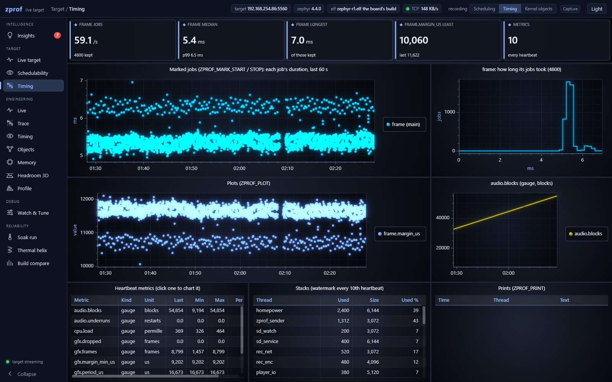
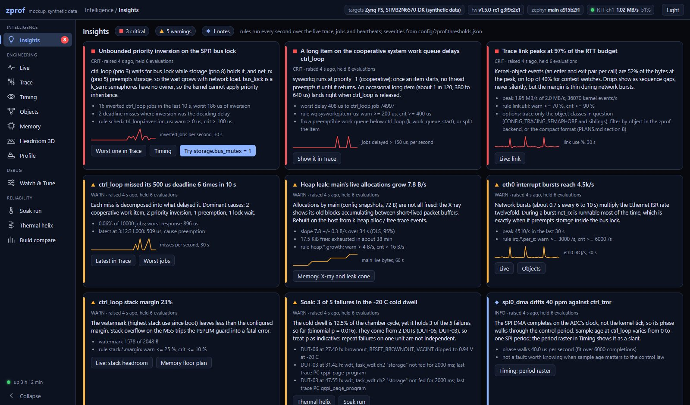
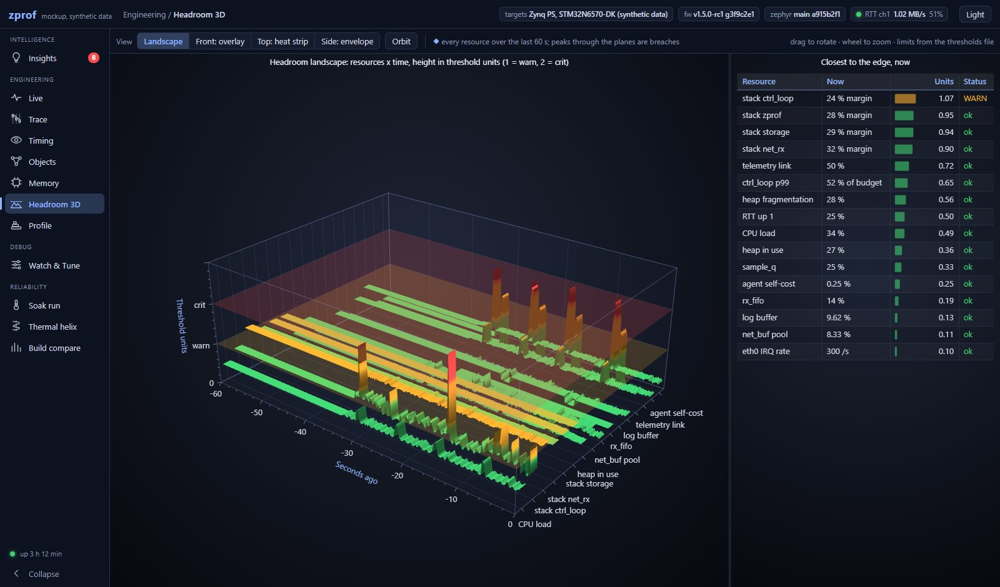
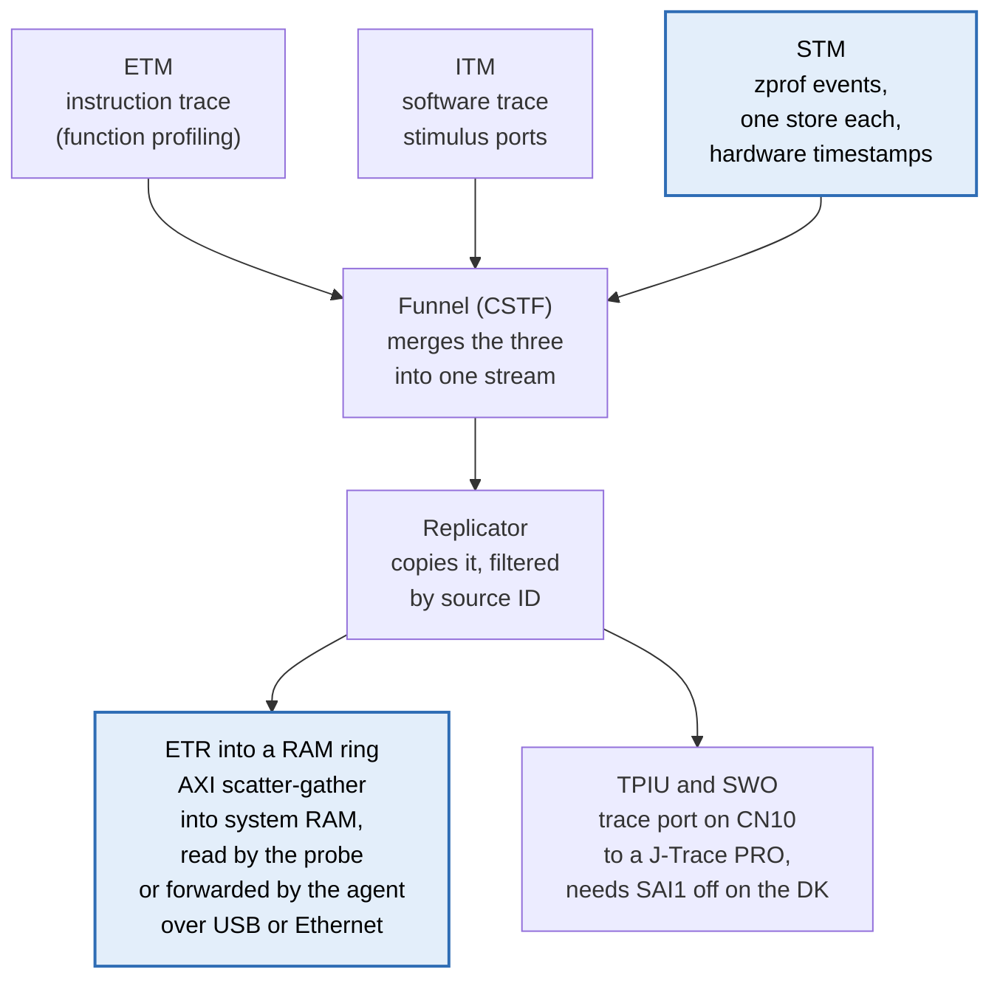

# zprof

Runtime tracing, timing analysis and telemetry for Zephyr RTOS, over the
target's own Ethernet, in the browser. A SystemView work-alike that needs no
debug probe and never halts the core: a Zephyr module records the scheduler,
interrupts, kernel objects and your own marks into a RAM ring; a sender thread
streams them over TCP; a Python bridge names everything from the ELF and
serves a GPU dashboard built on [Sferic](https://github.com/murr2k/sferic-charts).


**Status (v0.7.0).** Tested on one target: the
STM32N6570-DK (Cortex-M55 at 800 MHz) running Zephyr v4.4.0 and the
[stm32n6-demo](https://github.com/murr2k/stm32n6-demo) (60 Hz LVGL display,
2.7 ms audio refills, NPU, camera, H.264 encoder, Ethernet services). The
firmware module, the bridge and three dashboard views run on live data. The
other dashboard views are still the original mockup on a simulated target,
and say so on screen.

## Why zprof

A test that passes says the system met its deadlines this time. zprof says
how much room was left, where it went, and which coincidence would break it
first, while the target runs its real workload. The evidence column is from
the STM32N6570-DK demo.

| Feature | Benefit | On the demo |
|---|---|---|
| Tracing over the target's own Ethernet; no probe, no halt | Observe every operating mode on an ordinary board, with no licence notice and nothing that stops the core | The attract lap, the camera and the NPU observed live; SystemView's attach halts the core about 0.6 s |
| Low cost, measured by the target and always on screen | Leave it on during real tests; the observer effect is a number, not a guess | 159 to 171 ns a hook, 1.2 to 2 % of the CPU on Home (up to 3.7 % with every kernel object); a full regression tour with zprof streaming: 0 dropped frames, 0 audio underruns |
| Heartbeat metrics on the trace's clock, cross-checked against the trace | Verify the application's own counters with a second instrument | Frames, refresh period, least frame margin and audio refills all equal the demo's counts; per-thread CPU within 0.03 points of the kernel's |
| Schedulability analysis from measurement | Margins instead of pass or fail: slack per deadline, how far every execution time can grow, the bound for each deadline with its causes | Home: 3 of 3 deadlines met, main 20 % slack, every execution time can grow 6 % |
| Job marks (`ZPROF_MARK_START/STOP`) | Exact jobs for loops the kernel cannot see, so the analysis stops guessing | main's frame is 6.4 ms of work; without marks a whole 15.6 ms period was assumed and main looked like it could miss |
| What-ifs on the measured model | Try a priority, execution time, period or deadline change before touching code | Recommendations name the interfering thread and the change to try |
| Kernel objects with wait reasons, owners and call sites (`file.c:line`) | See what each thread waits for and where, and tell idle rest from contention | A TCP connection's mutex contended up to 7.5 ms, partly by zprof's own sender: the tool reports its own effect too |
| Event-loop shapes | An architecture check from the running system: active objects, wait points, handlers that block | Audio, microphone, Ethernet, player I/O, NPU and card watcher are active objects; main is a marked job loop with one wait point; the web and Home Power services are sequential loops with 3 to 10 wait points |
| Capture-then-upload | A window with no trace traffic on the network at all, for the cases where streaming would disturb the measurement | 4 MB, 8 s of the attract lap with two 1.5 MB screenshots sent meanwhile: no record lost |
| The core's PMU, per thread (`--pmu-threads`) | Tell compute from waiting on memory: instructions per cycle, cache refills, stall share, Helium share, for each thread | Home's UI thread: IPC 0.42, 13 data-cache refills per 1000 instructions, a third of its cycles stalled in the back end (memory-bound frame fills); Signal Lab: 3 % of its instructions Helium, the audio threads none |
| Faults captured (`fault`, opt-in) | The registers, the call trace named from the ELF and the moments before a fault reach the PC; the failure policy stays the application's (zprof's own handler, halting or running on, only if chosen) | The demo chose to run on: a divide by zero in a test thread was named to its source line, no frame was dropped, and its status bar, Settings, web remote and this dashboard listed the dead thread |
| Bus records (`--proto i2c,disk`; Ethernet opt-in) | I2C messages, disk transfers and Ethernet frames on the trace's clock; the frames as pcapng for Wireshark | Camera screen: 26 I2C messages a second to the image sensor, the slowest 5.3 ms; a clip from the card: 0.61 MB/s of reads, the slowest 19 ms; Wireshark reads the export |
| PC sampling (`--sample HZ`, opt-in) | A statistical profile by function, per thread and per interrupt, with the caller of leaf functions, from a timer interrupt the port supplies; it costs almost nothing, so frame times stay true | 4,000 samples a second for 0.13 % of the CPU (the handler's mean run, 0.3 us). Deck's first frames: 31 % fills and blends (LVGL's Helium routines), 27 % styles and the object tree, 18 % glyphs. LVGL 9.5's blur walk, which every invalidation runs over all objects, was 12 % of the UI thread on Home and Deck; nothing in the demo uses blur |
| Spans (`--spans US[,DEPTH]`, opt-in) | What a frame is made of, as a tree: `ZPROF_SPAN_*` in the application and LVGL's own profiler points (layout, refresh, draw tasks, events) with no change to LVGL; the target leaves out spans shorter than asked | A Deck first frame makes 3,976 spans, 550 of 20 us or more kept; 42 labels drawn take 4.2 ms. Spans slow the code they measure (Deck's first frame, 12.9 ms, takes 15.4 ms while LVGL's points record): read them for structure, time frames without them |
| Flight recorder (`ZPROF_TRIGGER`) | Catch an event nobody can reproduce on demand: armed, the board records while nobody is connected and keeps the moments before the application's trigger for the next client | A dropped frame on Home: 0.4 s before it kept in the 64 KB ring, the frame's 35.9 ms named as the main thread's own work |
| Recordings, a replay-equals-live check, Perfetto export | Regression evidence: compare builds run against run, and share a trace | 481,881 records decoded identically in different pieces |
| A link that recovers by itself | Cable pulls, resets and reflashes need no restart of anything | Streaming resumed 0.5 s after a 4 s carrier drop, 0 records lost |
| Names from the ELF, checked against a build id | No strings on the target, and a trace analysed against the wrong build is flagged | About 10 KB of flash and 7 KB of internal RAM; the 64 KB ring in the M55's DTCM |
| A browser dashboard, Apache-2.0 | Nothing to license, and a page anyone on the team can open | The screenshots in this README, taken from the board live |

### What it found in a demo that already passed its tests

- **Network receive, not graphics, is the biggest interference.** On Home,
  network receive threads are the largest share of the main thread's bound.
  The network's cooperative threads (Ethernet receive, the TCP work queue)
  run at the audio thread's own priority, and a 1.5 MB transfer drives up
  to 130,000 events a second.
- **A latent audio risk on the Camera screen.** The microphone thread
  normally runs about 22 us a job, but ran up to 1.7 ms there: its ring is in
  PSRAM, which the NPU and the camera also use. It is cooperative, so the audio
  thread can wait behind it for up to 63 % of its 2.68 ms deadline. Underruns
  are still 0; the margin depends on worst cases not coinciding.
- **Starvation below the long runners.** The NPU's 65 to 130 ms runs and the
  video decoder starved anything below them; zprof's own sender had to move
  from priority 14 to 1.
- **Something periodic on Home.** Its frames fall into two bands, about 5.3
  and 6.3 ms, visible in the Timing view and not yet explained.

### Security and privacy

- **zprof's port (TCP 5560) has no login and no encryption.** Anyone who can
  reach it can read the trace and change what is recorded. Use it on a
  development network, never across the boundary of a secure perimeter. The
  bridge serves the dashboard on 127.0.0.1 only.
- **What a trace can hold:** thread names, code addresses (function names with
  the ELF), timing; with bus records, I2C addresses and timing, and only by a
  further opt-in (`CONFIG_ZPROF_BUS_I2C_DATA`) the first 8 data bytes of each
  message, which can be sensitive (a touch controller on a PIN pad, a secure
  element), and disk sector numbers; fault records hold register values, which
  may include data the faulting code was handling.
- **Beyond the scheduler, everything is opt-in at build time:** the PMU
  (zprof takes it over), fault capture and its handler, the bus records and
  their wraps of driver functions, spans (and LVGL's profiler points as spans),
  PC sampling and its timer interrupt. Adding zprof records thread switches,
  interrupts, kernel objects and metrics, and changes nothing else.
- **Ethernet capture is a build-time opt-in** (`CONFIG_ZPROF_BUS_ETH_RX`,
  `CONFIG_ZPROF_BUS_ETH_STM32_TX`, both off by default). Frame headers name
  every host the target talks to (MAC and IP addresses, ports), and built in,
  the capture can be switched on by anyone who reaches the port.
- **Adding zprof does not change how a device fails.** Fault capture is off by
  default; an application calls `zprof_fault_capture()` from its own fatal
  error handler and keeps its policy, or opts into zprof's handler
  (`CONFIG_ZPROF_FAULT_HANDLER`: halts as Zephyr does) and, separately, into
  running on after a thread's fault (`CONFIG_ZPROF_FAULT_CONTINUE`). Neither
  halting nor running on is safe for every system: a halted CPU can leave a
  power stage's switch on, running on can leave a control loop dead. The
  product decides, and its safety net belongs in hardware (a watchdog, a
  timer's break input).
- **Treat recordings, exports and screenshots of traffic as sensitive:** keep
  them out of public repositories and tickets. `--anonymize` (`summary`,
  `capture`, `export --pcapng`) replaces hosts with documentation addresses
  (192.0.2.0/24 and stand-in MACs) and zeroes payload bytes past the headers;
  a `.zpr` recording itself keeps the real headers.

### Limits

- Verdicts hold "under the load observed": measured, not proved. Observe
  one operating mode at a time; an observation that mixes modes overstates
  the risk.
- zprof adds network traffic of its own, and it shows up as interference.
- Tested on one target so far: a Cortex-M55 on Zephyr v4.4.0.

## What it records

- **Scheduling:** every thread switch with its reason (preempted, pending on
  which wait queue, sleeping, suspended) and, when it blocks, the call site of
  the blocking call (named `file.c:line (function)` from the ELF); every
  interrupt by IRQ number and handler; idle; ready, pend, priority, create,
  abort, rename.
- **Kernel objects:** semaphores, mutexes (with the owner a thread waits on),
  message queues, queues, sleeps, polls, timer expiry functions and work items,
  one record per call unless it blocks. Which classes to record is chosen at
  run time from the page (Scheduling, Timing, Kernel objects presets).
- **Application data:** `ZPROF_MARK_START/STOP` around a job the kernel cannot
  see (a frame), `ZPROF_PLOT` values, `ZPROF_PRINT` lines (formatted on the
  host), `ZPROF_TRIGGER` (a missed deadline, say: it freezes the flight
  recorder), and metrics (counters, gauges, timers) latched by a heartbeat every
  100 ms, with each thread's stack watermark every tenth beat.
- **The core (Armv8.1-M PMU):** four counts at a time, every heartbeat and, on
  request, at every thread switch: instructions, cache refills, stall cycles,
  Helium (MVE) instructions.
- **Faults (opt-in):** the registers, the thread and a call trace, from the
  application's fatal error handler or zprof's; with zprof's handler and
  `CONFIG_ZPROF_FAULT_CONTINUE`, a thread that faults ends and the target runs
  on, unless it is an interrupt, main or idle.
- **Buses, on request:** I2C messages, disk transfers and (built in by choice)
  Ethernet frame headers.
- **Inside a frame, on request (opt-in):** PC samples from a timer of the
  port's (where the CPU was, in which thread or interrupt), and spans
  (`ZPROF_SPAN_BEGIN/END`, and LVGL's own profiler points) of at least the
  length asked for, as a tree.
- **Time:** the DWT cycle counter (it runs through WFI on the N6, measured),
  tied to the kernel's 64-bit cycle count every 250 ms; the host places every
  session on the target's clock since boot, so a reconnect continues the same
  timeline.

Three ways to get it off the target: **streaming** (TCP 5560, one client; a
broken link recovers by itself at both ends), **capture-then-upload** (the
hooks write into a RAM buffer, nothing but a status goes on the network until
the capture ends, then it uploads as an ordinary stream), or the **flight
recorder** (armed, the hooks keep recording into the ring with nobody
connected, the oldest records making room; `ZPROF_TRIGGER()` in the
application freezes it shortly after, and the next client collects it first:
[docs/PROTOCOL.md](docs/PROTOCOL.md) section 4c).

## What you see

| View | Shows |
|---|---|
| **Live target** (`#target`) | KPIs (CPU busy, switches, interrupts, events and bytes, records dropped, zprof's own cost), the scheduler timeline (interrupts by handler, threads by priority, waits drawn as rest or contention; a scope-like trigger on any lane, and Hold / Live: a zoom holds what is in view), CPU by thread, thread, interrupt and kernel-object tables |
| **Schedulability** (`#sched`) | Response-time analysis of the measured system against declared deadlines: jobs per thread, arrival and workload curves, Zephyr's cooperative threads as blocking, self-suspension, slack, how far each thread can grow, the scaling factor, Audsley's order, event-loop shapes (active object or not), recommendations, what-ifs analysed by the bridge. [docs/SCHEDULABILITY.md](docs/SCHEDULABILITY.md) |
| **Timing** (`#ltiming`) | Marked jobs and their spread, plots, the heartbeat's metrics, stack watermarks, prints |

| | |
|---|---|
|  Schedulability, one minute of the demo's Home screen |  Timing: the demo's frame jobs and frame margin |

From the command line, `python -m zprof_bridge`:

| Command | Does |
|---|---|
| `discover` | Finds boards (the stm32n6-demo's discovery query) |
| `capture` | Records a session to a replayable `.zpr` (`--buffer`: capture-then-upload) |
| `recorder` | The flight recorder: `arm` (`--post-ms`), `off`, `status`; a held recording is saved to a `.zpr` first, with how far before the trigger it reaches |
| `fault` | A fault the target holds: reason, thread, PC, LR and the call trace named from the ELF, saved with the frozen ring; `--wait` shows faults as they come |
| `capture`, `serve` options | `--pmu cache\|helium` and `--pmu-threads` (PMU counts per thread), `--proto eth,i2c,disk\|all` (bus records), `--spans US[,DEPTH]` (spans of at least US microseconds: `ZPROF_SPAN_*` and LVGL's profiler points), `--sample HZ` (PC samples) |
| `export --pcapng` | A recording's Ethernet frames for Wireshark |
| `summary` | Per-thread CPU, interrupts, wake latency, kernel objects, zprof's own cost; with spans or samples: spans by name, functions by samples, and the longest frames as span trees |
| `sched` | The schedulability analysis as text |
| `check` | Replay equals live: a recording decoded in different pieces gives the same answers |
| `export` | Trace Event JSON for [ui.perfetto.dev](https://ui.perfetto.dev) |
| `serve` | The live bridge for the dashboard (or `--replay` a recording), WebSocket on 127.0.0.1:8786 |

## Measured on the STM32N6570-DK

The rule zprof is held to: it may change the run-time profile as long as the
application still meets its deadlines. On the demo the gate is its own
regression tour (every screen, transitions, video, uploads, a 170 s attract
lap) with zprof streaming.

| Item | Measured |
|---|---|
| The gate | Full tour with the bridge streaming: 0 dropped frames, 0 audio underruns |
| A hook | 159 to 171 ns (measured by the target at every connection, shown on the page) |
| Event rate | 9,800, 10,600 and 15,700 events a second on the Home screen with the Scheduling, Timing and Kernel objects presets; bursts to 130,000 a second during a 1.5 MB network transfer |
| zprof's own CPU | 1.15, 1.30 and 1.96 % on Home with those presets (sender time plus events times the hook cost); 2 to 3.7 % with kernel objects through a whole tour |
| Footprint | About 10 KB of flash and 7 KB of internal RAM, the 64 KB ring in the core's DTCM (`ZPROF_RING_DTCM`, on where the board chooses `zephyr,dtcm`; in internal RAM otherwise); the capture buffer (4 MB of PSRAM on the demo) is taken at the first capture |
| Agreement | Per-thread CPU within 0.03 points of the kernel's own counts; frame marks equal the demo's frame counter; audio refill wakeups 22,300 of the DAC's 22,300 blocks; the least plotted frame margin equals the demo's own at all 560 heartbeats (`integrations/stm32n6-demo/p3check.py`) |
| Capture | 4 MB held 8 s of the attract lap with two 1.5 MB screenshots sent meanwhile: no record lost inside the window |

## Getting started

### Firmware

Requirements: Zephyr v4.4.0 (pinned in `firmware/west.yml`; the hooks zprof
does not record are generated from the tree's `tracing.h` at configure time),
networking with BSD sockets, a Cortex-M with a DWT cycle counter for the
timestamps (the kernel's cycle counter otherwise; only the M55 is tested).

Build your application with the module and a conf file:

```powershell
west build -b <board> <app> -- -DZEPHYR_EXTRA_MODULES=<zprof>/firmware/zprof -DEXTRA_CONF_FILE=zprof.conf
```

```ini
# zprof.conf
CONFIG_TRACING=y
CONFIG_TRACING_CUSTOM=y
CONFIG_ZPROF=y
# default y with TRACING, and wrong here: syscall tracing hooks every syscall
# site, and the network classes would trace zprof's own packets
CONFIG_TRACING_SYSCALL=n
CONFIG_TRACING_NETWORKING=n
CONFIG_TRACING_PM=n
```

Options are in `firmware/zprof/Kconfig` (ring size, sender priority, capture
buffer size, heartbeat period); the demo's choices and why are in its
`app/zprof.conf`. Marks, plots, prints and metrics:

```c
#ifdef CONFIG_ZPROF
#include <zprof/zprof.h>
#else
#define ZPROF_MARK_START(name)       do { } while (0)
#define ZPROF_MARK_STOP(name, value) do { (void)(value); } while (0)
#endif

ZPROF_MARK_START("frame");
render();
ZPROF_MARK_STOP("frame", 1);          /* 0: nothing was done, no job */
```

Names and formats must be string literals: only their addresses go over the
wire and the host reads the text from the ELF. Two weak port hooks:
`zprof_port_alloc()` gives the capture buffer, `zprof_port_heartbeat()` sets
gauges from the application's own counters before each heartbeat
(`zprof.h` has the API). The wire format: [docs/PROTOCOL.md](docs/PROTOCOL.md).

### Bridge

Python (tested with 3.13):

```powershell
python -m venv .venv
.venv\Scripts\pip install -r host\bridge\requirements.txt
cd host\bridge
..\..\.venv\Scripts\python -m zprof_bridge serve --host <board> --elf <build>\zephyr\zephyr.elf
```

`--irq-header` names interrupts with the chip's own names (a CMSIS device
header), `--deadlines` gives the Schedulability view its deadlines (the
demo's: `integrations/stm32n6-demo/deadlines.json`). Analyse a recording with
the ELF of the build that made it: the bridge checks a build id.

### Dashboard

Node.js 20 or newer and a browser with WebGL2 on a GPU (tested with Chrome).
The dashboard imports Sferic from source, checked out beside this repository
as `lightning` (zprof 0.7.0 is tested with Sferic's `main` at d115deb, the
first commit with the sortable tables it needs):

```powershell
git clone https://github.com/murr2k/sferic-charts.git ..\lightning
cd web; npm ci; npx vite      # or .\run.cmd from the root on Windows
```

Then open http://127.0.0.1:8781/#target with the bridge running. Typecheck
with `npx tsc --noEmit`.

### On the STM32N6570-DK

The stm32n6-demo includes zprof in every build: `west update` fetches it and
the demo's CMakeLists adds the module with the demo's settings. Its README
has the bridge's command; `integrations/stm32n6-demo/` here holds its
deadlines and the P3 exit check.

## The mockup views

The rest of the dashboard was designed first, on a simulated target
(`web/src/sim/target.ts`: a preemptive scheduler with kernel objects, a heap,
a PI-controlled motor, and planted bugs to find). Those views carry a
"simulated" label in the header until they are ported to live data: Insights, Live, Trace,
Timing (scheduling eye, period raster, jitter by cause), Objects (flow graph),
Memory (floor plan, heap X-ray), Headroom 3D, Profile, Watch & Tune, Soak run,
Thermal helix and Build compare. Their design is in
[docs/DASHBOARD_SPEC.md](docs/DASHBOARD_SPEC.md); every limit and pass
criterion comes from one thresholds file, `config/zprof.thresholds.json`.

| | |
|---|---|
|  Insights (simulated) |  Trace: vertical sequence with response anatomy (simulated) |
|  Objects (simulated) |  Memory (simulated) |
|  Headroom 3D (simulated) |  Thermal helix (simulated) |

Writing to a running target is part of that design and not built yet: writes
would go through a parameter registry in the agent (range-checked, applied by
the owning thread at a safe point, acknowledged with target timestamps),
behind an arm switch, with an audit trail
([DASHBOARD_SPEC.md section 14](docs/DASHBOARD_SPEC.md)).

## On-chip trace on the STM32N6 (candidate)

The N6 has a CoreSight trace subsystem that could carry the event trace
without the CPU's ring and sender:

- The agent writes each event to an STM stimulus port, a single store. The
  STM timestamps and serializes it in hardware.
- The ETR writes the merged trace (STM events, and ETM instruction trace when
  enabled) into a RAM ring over AXI. A probe reads the ring, or the agent
  forwards it over USB or Ethernet; the TPIU to a J-Trace is the other drain.
- Zephyr at the pin already decodes it (MIPI STP decoder, CoreSight
  deformatter, `arm,stmesp` binding). The N6 still needs an STM devicetree
  node and a funnel / ETF / ETR setup driver.



The highlighted path carries zprof events without a trace port. Not drawn:
the ETF trace FIFO, the second replicator and the CTIs (RM0486 section 78).
Not designed yet; the questions are in
[OBSERVABILITY_AND_SVD_REVIEW.md section 5](docs/OBSERVABILITY_AND_SVD_REVIEW.md).

## Repository layout

| Path | Contents |
|---|---|
| `firmware/zprof/` | The Zephyr module: tracing hooks (`CONFIG_TRACING_CUSTOM`), ring, TCP sender, heartbeat, application API (`include/zprof/zprof.h`), wire ids (`include/zprof/proto.h`) |
| `host/bridge/` | The bridge: stream decoder, ELF names, recordings, analysis, schedulability, Perfetto export, live server; tests on synthetic streams |
| `web/` | The dashboard (TypeScript, Vite, Sferic); `src/views/live*.ts` are the live views |
| `integrations/stm32n6-demo/` | The demo's zprof build conf, its deadlines and the P3 exit check |
| `config/` | Thresholds file and its schema |
| `host/svd/` | Generator for an annotated STM32N657 register workbook from ST's SVD (not included) |
| `docs/` | [PROTOCOL.md](docs/PROTOCOL.md) (wire format), [SCHEDULABILITY.md](docs/SCHEDULABILITY.md) (the analysis and its blind spots), [PLANS.md](docs/PLANS.md) (decisions, phases, research), [DASHBOARD_SPEC.md](docs/DASHBOARD_SPEC.md), [OBSERVABILITY_AND_SVD_REVIEW.md](docs/OBSERVABILITY_AND_SVD_REVIEW.md) |

Tests: `cd host\bridge; ..\..\.venv\Scripts\python -m pytest -q tests`.

## Roadmap

- **P4, the M55:** done in 0.5.0 and 0.6.0: PMU counts per heartbeat and per
  thread, Helium share, the flight recorder and triggers, faults captured with
  the target running on. Left: a fault that halts the target, kept through a
  reset and reported at the next boot (it needs a retained record a cold boot
  initialises, and flash boot: development boot parks the chip in the ROM).
- **Inside a frame:** spans (LVGL's profiler points among them) and PC sampling
  in 0.7.0. Left: both in the live dashboard (the bridge's summary and the
  Perfetto export show them today).
- **P5, protocol analyzer:** first slice in 0.6.0: I2C and disk records,
  Ethernet frames (opt-in) as pcapng with target timestamps. Left: decoders
  for the demo's own protocols, a Protocol view.
- The mockup views ported to live data; a second target (an AMD Zynq PS).

[PLANS.md](docs/PLANS.md) section 0 has the phases and their exit checks.
See [CHANGELOG.md](CHANGELOG.md) for what changed when.

## License

Apache-2.0 ([LICENSE](LICENSE), [NOTICE](NOTICE)). Sferic Charts, which the
dashboard imports, is MIT.
