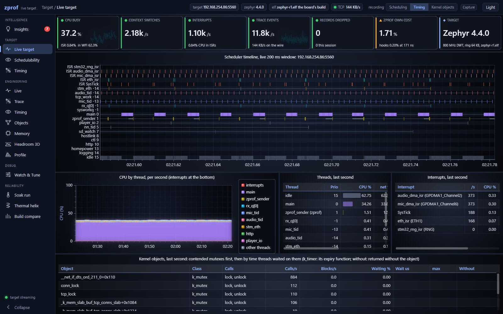
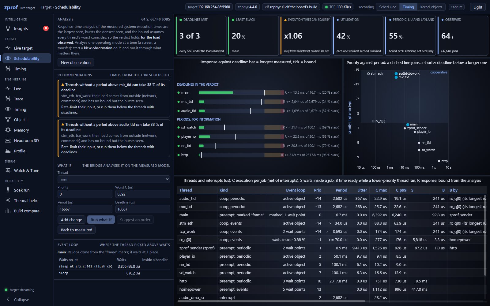
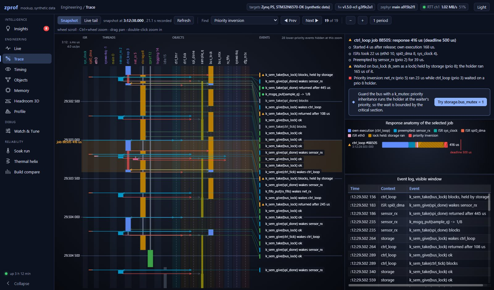
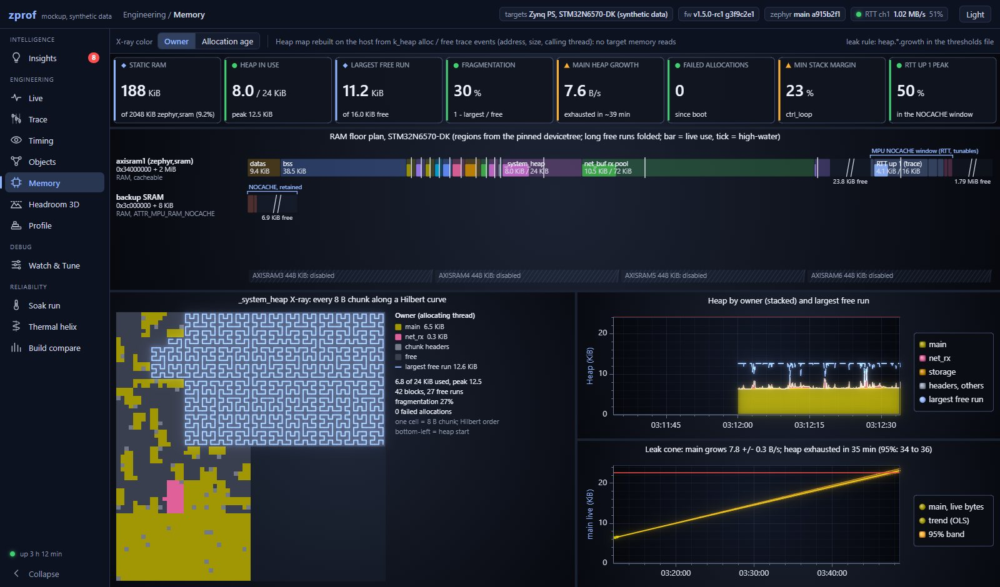
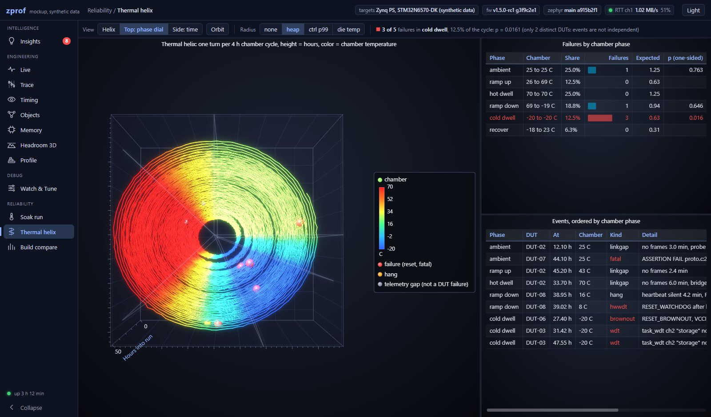
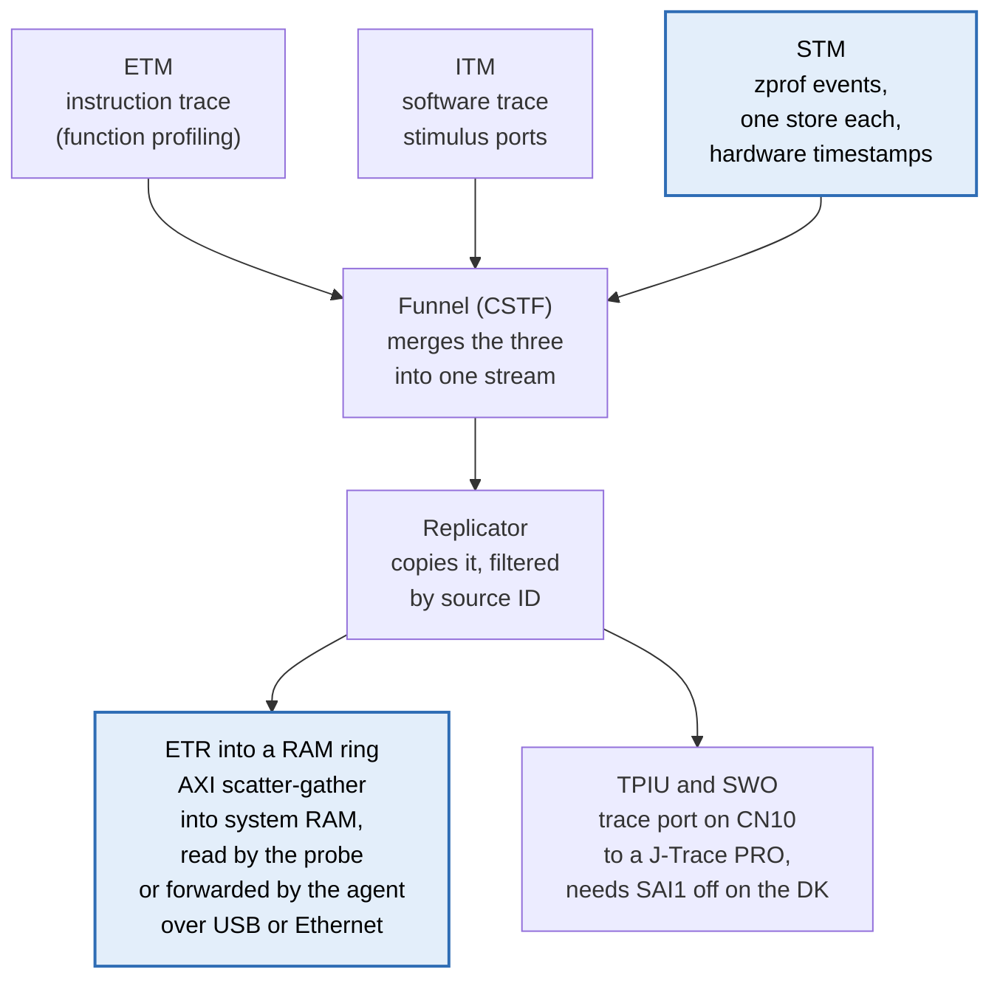

# zprof

Runtime tracing, timing analysis and telemetry for Zephyr RTOS, over the
target's own Ethernet, in the browser. A SystemView work-alike that needs no
debug probe and never halts the core: a Zephyr module records the scheduler,
interrupts, kernel objects and your own marks into a RAM ring; a sender thread
streams them over TCP; a Python bridge names everything from the ELF and
serves a GPU dashboard built on [Sferic](https://github.com/murr2k/sferic-charts).



**Status (v0.3.0, first public release).** Tested on one target: the
STM32N6570-DK (Cortex-M55 at 800 MHz) running Zephyr v4.4.0 and the
[stm32n6-demo](https://github.com/murr2k/stm32n6-demo) (60 Hz LVGL display,
2.7 ms audio refills, NPU, camera, H.264 encoder, Ethernet services). The
firmware module, the bridge and three dashboard views run on live data. The
other dashboard views are still the original mockup on a simulated target,
and say so on screen.

## What it records

- **Scheduling:** every thread switch with its reason (preempted, pending on
  which wait queue, sleeping, suspended) and, when it blocks, the call site of
  the blocking call (named `file.c:line (function)` from the ELF); every
  interrupt by IRQ number and handler; idle; ready, pend, priority, create,
  abort, rename.
- **Kernel objects:** semaphores, mutexes (with the owner a thread waits on),
  message queues, queues, sleeps, polls, timer expiry functions and work items,
  one record per call unless it blocks. Which classes to record is chosen at
  run time from the page (Scheduling, Timing, Kernel objects presets).
- **Application data:** `ZPROF_MARK_START/STOP` around a job the kernel cannot
  see (a frame), `ZPROF_PLOT` values, `ZPROF_PRINT` lines (formatted on the
  host), and metrics (counters, gauges, timers) latched by a heartbeat every
  100 ms, with each thread's stack watermark every tenth beat.
- **Time:** the DWT cycle counter (it runs through WFI on the N6, measured),
  tied to the kernel's 64-bit cycle count every 250 ms; the host places every
  session on the target's clock since boot, so a reconnect continues the same
  timeline.

Two ways to get it off the target: **streaming** (TCP 5560, one client; a
broken link recovers by itself at both ends), or **capture-then-upload** (the
hooks write into a RAM buffer, nothing but a status goes on the network until
the capture ends, then it uploads as an ordinary stream).

## What you see

| View | Shows |
|---|---|
| **Live target** (`#target`) | KPIs (CPU busy, switches, interrupts, events and bytes, records dropped, zprof's own cost), the scheduler timeline (interrupts by handler, threads by priority, waits drawn as rest or contention), CPU by thread, thread, interrupt and kernel-object tables |
| **Schedulability** (`#sched`) | Response-time analysis of the measured system against declared deadlines: jobs per thread, arrival and workload curves, Zephyr's cooperative threads as blocking, self-suspension, slack, how far each thread can grow, the scaling factor, Audsley's order, event-loop shapes (active object or not), recommendations, what-ifs analysed by the bridge. [docs/SCHEDULABILITY.md](docs/SCHEDULABILITY.md) |
| **Timing** (`#ltiming`) | Marked jobs and their spread, plots, the heartbeat's metrics, stack watermarks, prints |

| | |
|---|---|
|  Schedulability, one minute of the demo's Home screen |  Timing: the demo's frame jobs and frame margin |

From the command line, `python -m zprof_bridge`:

| Command | Does |
|---|---|
| `discover` | Finds boards (the stm32n6-demo's discovery query) |
| `capture` | Records a session to a replayable `.zpr` (`--buffer`: capture-then-upload) |
| `summary` | Per-thread CPU, interrupts, wake latency, kernel objects, zprof's own cost |
| `sched` | The schedulability analysis as text |
| `check` | Replay equals live: a recording decoded in different pieces gives the same answers |
| `export` | Trace Event JSON for [ui.perfetto.dev](https://ui.perfetto.dev) |
| `serve` | The live bridge for the dashboard (or `--replay` a recording), WebSocket on 127.0.0.1:8786 |

## Measured on the STM32N6570-DK

The rule zprof is held to: it may change the run-time profile as long as the
application still meets its deadlines. On the demo the gate is its own
regression tour (every screen, transitions, video, uploads, a 170 s attract
lap) with zprof streaming.

| Item | Measured |
|---|---|
| The gate | Full tour with the bridge streaming: 0 dropped frames, 0 audio underruns |
| A hook | 159 to 171 ns (measured by the target at every connection, shown on the page) |
| Event rate | 9,800, 10,600 and 15,700 events a second on the Home screen with the Scheduling, Timing and Kernel objects presets; bursts to 130,000 a second during a 1.5 MB network transfer |
| zprof's own CPU | 1.15, 1.30 and 1.96 % on Home with those presets (sender time plus events times the hook cost); 2 to 3.7 % with kernel objects through a whole tour |
| Footprint | About 8 KB of flash and 72 KB of internal RAM (64 KB of it the ring); the capture buffer (4 MB of PSRAM on the demo) is taken at the first capture |
| Agreement | Per-thread CPU within 0.03 points of the kernel's own counts; frame marks equal the demo's frame counter; audio refill wakeups 22,300 of the DAC's 22,300 blocks; the least plotted frame margin equals the demo's own at all 560 heartbeats (`integrations/stm32n6-demo/p3check.py`) |
| Capture | 4 MB held 8 s of the attract lap with two 1.5 MB screenshots sent meanwhile: no record lost inside the window |

## Getting started

### Firmware

Requirements: Zephyr v4.4.0 (pinned in `firmware/west.yml`; the hooks zprof
does not record are generated from the tree's `tracing.h` at configure time),
networking with BSD sockets, a Cortex-M with a DWT cycle counter for the
timestamps (the kernel's cycle counter otherwise; only the M55 is tested).

Build your application with the module and a conf file:

```powershell
west build -b <board> <app> -- -DZEPHYR_EXTRA_MODULES=<zprof>/firmware/zprof -DEXTRA_CONF_FILE=zprof.conf
```

```ini
# zprof.conf
CONFIG_TRACING=y
CONFIG_TRACING_CUSTOM=y
CONFIG_ZPROF=y
# default y with TRACING, and wrong here: syscall tracing hooks every syscall
# site, and the network classes would trace zprof's own packets
CONFIG_TRACING_SYSCALL=n
CONFIG_TRACING_NETWORKING=n
CONFIG_TRACING_PM=n
```

Options are in `firmware/zprof/Kconfig` (ring size, sender priority, capture
buffer size, heartbeat period); the demo's choices and why are in
`integrations/stm32n6-demo/zprof.conf`. Marks, plots, prints and metrics:

```c
#ifdef CONFIG_ZPROF
#include <zprof/zprof.h>
#else
#define ZPROF_MARK_START(name)       do { } while (0)
#define ZPROF_MARK_STOP(name, value) do { (void)(value); } while (0)
#endif

ZPROF_MARK_START("frame");
render();
ZPROF_MARK_STOP("frame", 1);          /* 0: nothing was done, no job */
```

Names and formats must be string literals: only their addresses go over the
wire and the host reads the text from the ELF. Two weak port hooks:
`zprof_port_alloc()` gives the capture buffer, `zprof_port_heartbeat()` sets
gauges from the application's own counters before each heartbeat
(`zprof.h` has the API). The wire format: [docs/PROTOCOL.md](docs/PROTOCOL.md).

### Bridge

Python (tested with 3.13):

```powershell
python -m venv .venv
.venv\Scripts\pip install -r host\bridge\requirements.txt
cd host\bridge
..\..\.venv\Scripts\python -m zprof_bridge serve --host <board> --elf <build>\zephyr\zephyr.elf
```

`--irq-header` names interrupts with the chip's own names (a CMSIS device
header), `--deadlines` gives the Schedulability view its deadlines (the
demo's: `integrations/stm32n6-demo/deadlines.json`). Analyse a recording with
the ELF of the build that made it: the bridge checks a build id.

### Dashboard

Node.js 20 or newer and a browser with WebGL2 on a GPU (tested with Chrome).
The dashboard imports Sferic from source, checked out beside this repository
as `lightning`:

```powershell
git clone https://github.com/murr2k/sferic-charts.git ..\lightning
cd web; npm ci; npx vite      # or .\run.cmd from the root on Windows
```

Then open http://127.0.0.1:8781/#target with the bridge running. Typecheck
with `npx tsc --noEmit`.

### On the STM32N6570-DK

The stm32n6-demo fetches zprof with `west update` and builds it into a
separate build directory; its README has the commands.

## The mockup views

The rest of the dashboard was designed first, on a simulated target
(`web/src/sim/target.ts`: a preemptive scheduler with kernel objects, a heap,
a PI-controlled motor, and planted bugs to find). Those views carry a
"simulated" label in the header until they are ported to live data: Insights, Live, Trace,
Timing (scheduling eye, period raster, jitter by cause), Objects (flow graph),
Memory (floor plan, heap X-ray), Headroom 3D, Profile, Watch & Tune, Soak run,
Thermal helix and Build compare. Their design is in
[docs/DASHBOARD_SPEC.md](docs/DASHBOARD_SPEC.md); every limit and pass
criterion comes from one thresholds file, `config/zprof.thresholds.json`.

| | |
|---|---|
|  Insights (simulated) |  Trace: vertical sequence with response anatomy (simulated) |
|  Objects (simulated) |  Memory (simulated) |
|  Headroom 3D (simulated) |  Thermal helix (simulated) |

Writing to a running target is part of that design and not built yet: writes
would go through a parameter registry in the agent (range-checked, applied by
the owning thread at a safe point, acknowledged with target timestamps),
behind an arm switch, with an audit trail
([DASHBOARD_SPEC.md section 14](docs/DASHBOARD_SPEC.md)).

## On-chip trace on the STM32N6 (candidate)

The N6 has a CoreSight trace subsystem that could carry the event trace
without the CPU's ring and sender:

- The agent writes each event to an STM stimulus port, a single store. The
  STM timestamps and serializes it in hardware.
- The ETR writes the merged trace (STM events, and ETM instruction trace when
  enabled) into a RAM ring over AXI. A probe reads the ring, or the agent
  forwards it over USB or Ethernet; the TPIU to a J-Trace is the other drain.
- Zephyr at the pin already decodes it (MIPI STP decoder, CoreSight
  deformatter, `arm,stmesp` binding). The N6 still needs an STM devicetree
  node and a funnel / ETF / ETR setup driver.



The highlighted path carries zprof events without a trace port. Not drawn:
the ETF trace FIFO, the second replicator and the CTIs (RM0486 section 78).
Not designed yet; the questions are in
[OBSERVABILITY_AND_SVD_REVIEW.md section 5](docs/OBSERVABILITY_AND_SVD_REVIEW.md).

## Repository layout

| Path | Contents |
|---|---|
| `firmware/zprof/` | The Zephyr module: tracing hooks (`CONFIG_TRACING_CUSTOM`), ring, TCP sender, heartbeat, application API (`include/zprof/zprof.h`), wire ids (`include/zprof/proto.h`) |
| `host/bridge/` | The bridge: stream decoder, ELF names, recordings, analysis, schedulability, Perfetto export, live server; tests on synthetic streams |
| `web/` | The dashboard (TypeScript, Vite, Sferic); `src/views/live*.ts` are the live views |
| `integrations/stm32n6-demo/` | The demo's zprof build conf, its deadlines and the P3 exit check |
| `config/` | Thresholds file and its schema |
| `host/svd/` | Generator for an annotated STM32N657 register workbook from ST's SVD (not included) |
| `docs/` | [PROTOCOL.md](docs/PROTOCOL.md) (wire format), [SCHEDULABILITY.md](docs/SCHEDULABILITY.md) (the analysis and its blind spots), [PLANS.md](docs/PLANS.md) (decisions, phases, research), [DASHBOARD_SPEC.md](docs/DASHBOARD_SPEC.md), [OBSERVABILITY_AND_SVD_REVIEW.md](docs/OBSERVABILITY_AND_SVD_REVIEW.md) |

Tests: `cd host\bridge; ..\..\.venv\Scripts\python -m pytest -q tests`.

## Roadmap

- **P4, the M55:** PMU totals per heartbeat, then per thread at switches;
  Helium (MVE) share; post-mortem ring and triggers; faults captured and
  symbolised after a reboot.
- **P5, protocol analyzer:** bus transfers as records (I2C, SD), Ethernet as
  pcapng with target timestamps, decoders for the demo's own protocols, a
  Protocol view.
- The mockup views ported to live data; a second target (an AMD Zynq PS).

[PLANS.md](docs/PLANS.md) section 0 has the phases and their exit checks.
See [CHANGELOG.md](CHANGELOG.md) for what changed when.

## License

Apache-2.0 ([LICENSE](LICENSE), [NOTICE](NOTICE)). Sferic Charts, which the
dashboard imports, is MIT.
