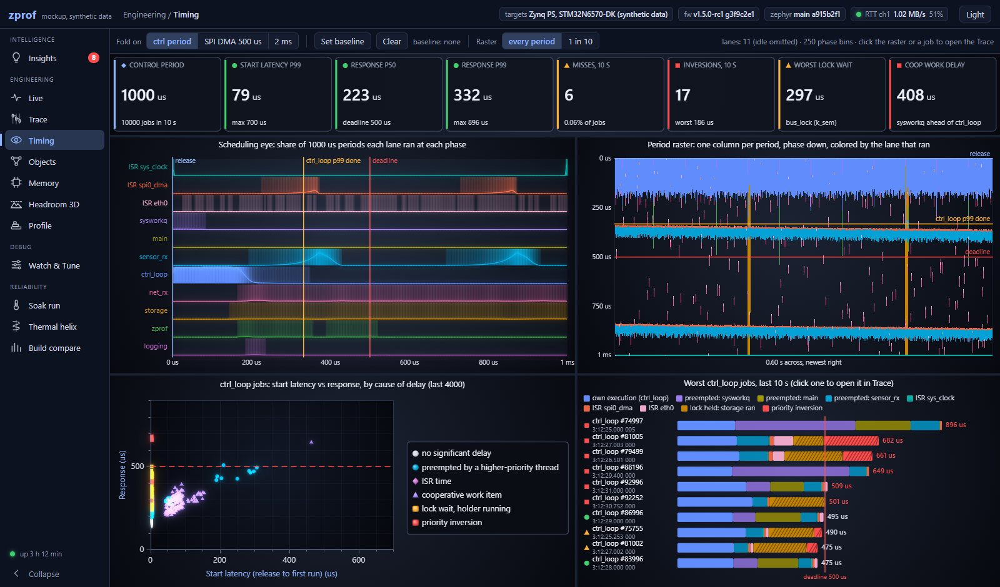
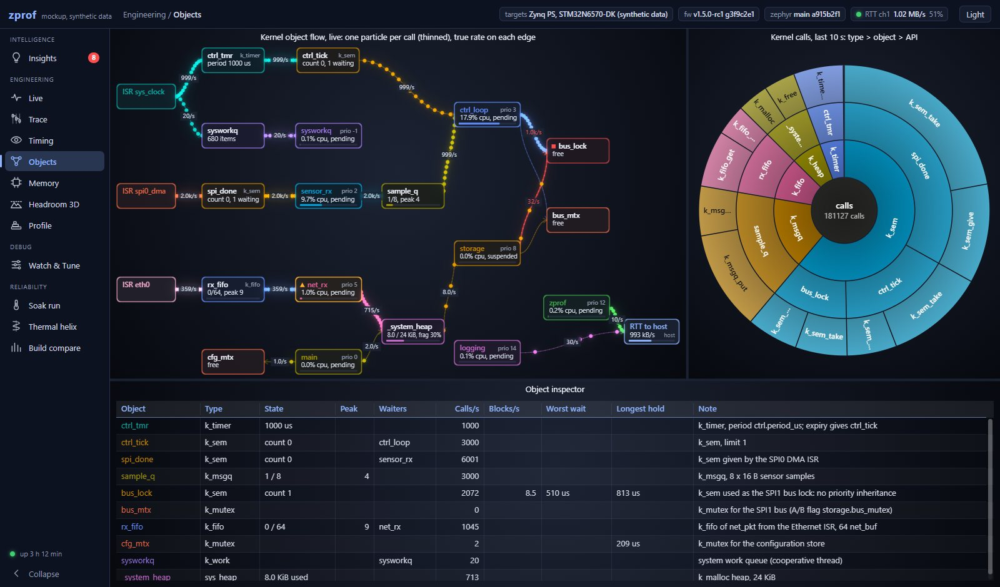
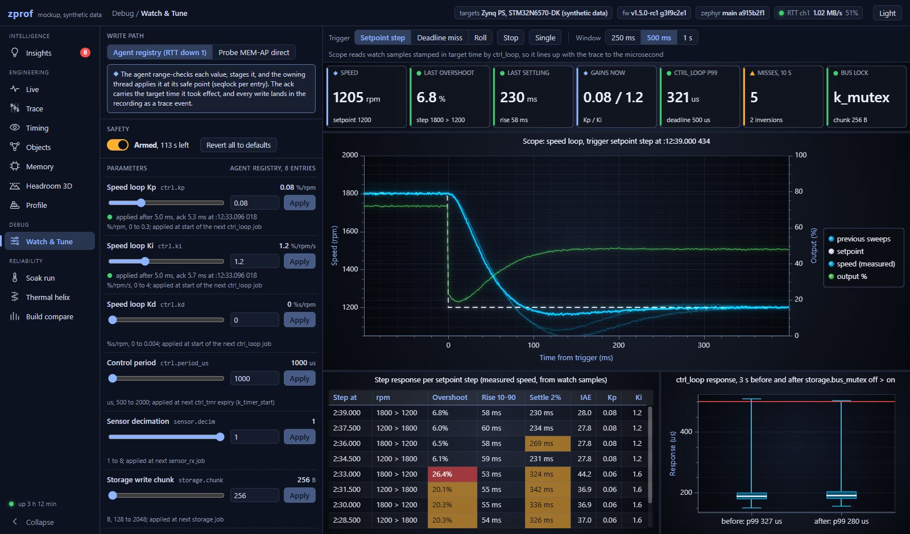
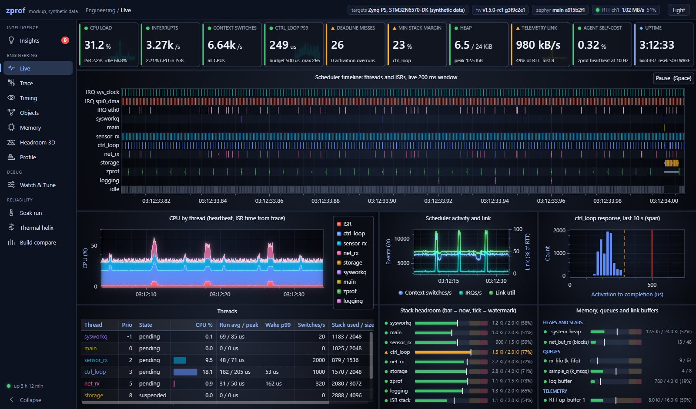

# zprof

Execution profiler and telemetry dashboard for Zephyr RTOS: a firmware agent
and a host bridge feeding a GPU dashboard built on Sferic. One app for two
audiences: firmware engineers doing development and design verification
(timelines, latency, headroom, profiles, live tuning) and QA engineers running
reliability tests (soak runs, faults, MTBF, build regression).


**Status (v0.2.0):** design and a running dashboard mockup on synthetic data.
The specification, plan, thresholds file and Zephyr pin are in place; the
firmware agent and the host bridge are not started. Every number in the mockup
comes from a simulated target that behaves like the real one should (section
"How the mockup works").

## Feature spec sheet

### At a glance

| Item | Specification |
|---|---|
| RTOS | Zephyr, `main` pinned by SHA (a915b2f1, 2026-10-16, 4.5 development) in `firmware/west.yml` |
| Targets | AMD Zynq PS (part to be chosen) and ST STM32N6570-DK (Cortex-M55 at 800 MHz) |
| Firmware agent (planned) | Clean-room, Memfault-style: metric registry, 10 Hz heartbeat (1 Hz in soak), CBOR via zcbor, COBS frames with per-channel sequence numbers, spans / states / marks, parameter registry and watch block, fatal record and last-gasp uptime in retained RAM |
| Transport (planned) | SEGGER RTT through a J-Link / J-Trace (planning number 2 MB/s), USB CDC ACM, UART, Ethernet; replay from recordings |
| Trace | Planning default: Zephyr CTF passed through unchanged (scheduler, ISR and kernel-object events), so `trace_viewer.py`, Perfetto and babeltrace2 still read the captures. Phase A decides between CTF, a zprof format and, on the N6, the on-chip STM (PLANS.md section 8) |
| Host bridge (planned) | Python, asyncio, WebSocket to the browser; decode, record, replay, derive (jobs, lock ownership, inversion, heap map, insight rules) |
| Dashboard | TypeScript + Vite on [Sferic](https://github.com/murr2k/sferic-charts) (WebGL2, one shared context, glow, 3D); 12 views; dark and daylight themes |
| Status encoding | Color plus shape on every status (ok circle, warn triangle, crit square, info diamond, idle ring) |
| Limits | One thresholds file (`config/zprof.thresholds.json`, JSON Schema 2020-12): 23 live alarm rules, 9 run pass criteria, 7 build-gate rules, shared by bridge, dashboard and report |
| Parameter catalog | 108 telemetry parameters across 13 domains plus 8 application-metric kinds, each with its Zephyr source checked at the pinned SHA |
| Mockup verification | `tsc --noEmit` clean; all 12 views in both themes render with zero page errors and zero WebGL warnings in headless Chrome on the GPU; scripted end-to-end runs for navigation, tuning and pause |

### Views

| Group | View | Answers | Highlights |
|---|---|---|---|
| Intelligence | **Insights** | What should I look at first? | Eleven rules run every second over the live streams; each finding has evidence, a trend, links to the proof and a fix to try. Severities from the thresholds file. Badge on the rail |
| Engineering | **Live** | What is the system doing right now? | KPI strip, scheduler timeline (threads and ISRs), CPU by thread, rates and link, latency histogram, thread table, stack and memory headroom bullets; Pause / resume with catch-up |
| | **Trace** | What happened, in order, and why was this job late? | Vertical sequence trace: time down, ISRs, threads and kernel objects as columns, causal arrows, an event field of annotations with leader lines; response anatomy and a plain-language explanation; find next miss / inversion / lock wait / parameter change; snapshot or live tail |
| | **Timing** | Is the schedule stable, and when not, why? | Scheduling eye (trace folded modulo a period, ghost baseline), period raster (drift shows as a slant), jitter constellation by cause, the ten worst jobs taken apart |
| | **Objects** | Who talks to whom, and where is it stuck? | Live kernel-object flow graph with a GPU particle per call and true rates, inversion alarm; kernel-call sunburst; object inspector |
| | **Memory** | Where did RAM go, and is the heap healthy? | RAM floor plan in true address order (regions from the devicetree, free runs folded), heap X-ray on a Hilbert curve by owner or age, heap by owner, leak cone with time to exhaustion |
| | **Headroom 3D** | What is closest to its limit? | Every budgeted resource as a ribbon in threshold units with warn and crit planes; camera presets turn it into an overlay, a status strip chart or an envelope |
| | **Profile** | Where does the time go inside the code? | Flame graph, hot functions, self time by module |
| Debug | **Watch & Tune** | What does this change do, live? | Parameter writes through the agent with arm switch, range checks, safe points and acks; triggered scope with persistence; step-response metrics; before / after box plots; audit trail |
| Reliability | **Soak run** | Did the run pass? | Verdict from the criteria, run timeline per DUT, leak fits with confidence bands, MTBF lower bound, fleet table, fault signatures |
| | **Thermal helix** | Do failures depend on temperature? | Each DUT as a helix, one turn per chamber cycle; the top view is a phase dial; failures by phase with a binomial test |
| | **Build compare** | Did build B regress? | Gate verdict (BLOCK / REVIEW / PASS) from footprint, CPU, latency, stack, tests and coverage |

### Intelligence built in

- **Response decomposition.** Every job's response time is split into own
  execution, each ISR, each preempting thread, time the lock holder ran, and
  priority inversion (medium-priority threads running while a higher-priority
  thread waits on a lower-priority holder).
- **Insight rules:** unbounded priority inversion, deadline misses by cause,
  long items on a cooperative work queue, lock hold length, heap leak with
  time to exhaustion, fragmentation, interrupt bursts, stack margin, the link
  cost of tracing (observer effect), clock-domain drift in ppm fitted from
  event timing, and temperature-phase clustering of soak failures.
- **Statistics, not eyeballing:** OLS slopes with 95% intervals, MTBF lower
  bounds from the chi-square distribution, binomial tests flagged as indicative
  when the events are not independent, and verdicts that never pass an
  unmeasured criterion (FAIL > INCOMPLETE > WARN > PASS).

### Writing to a running target

Poking variables at run time is part of the design, done safely:

- Writes go through the agent's parameter registry: the agent range-checks
  the value, stages it, and the owning thread applies it at a declared safe
  point, then acks with target timestamps. Each step is a trace event.
- An arm switch with a timeout gates every write; suggestions from Insights or
  Trace only stage a value; every request lands in an audit trail; "revert
  all" restores the defaults.
- The debug-probe path (J-Link memory access while the core runs) is
  read-only, because of cache coherence, torn multi-word writes and
  register-cached variables. Details in [DASHBOARD_SPEC.md section 14](docs/DASHBOARD_SPEC.md).

### Telemetry catalog

Identity and session, telemetry link and observer effect, CPU and scheduling,
interrupts, memory (stacks, heaps, slabs, layout, allocator map), kernel
objects and queues, faults, resets and lifecycle, peripherals and buses,
power, clocks and environment, application metrics, function profile, build
and test artifacts, run sessions. Every row names its Zephyr API or Kconfig
symbol, its provenance class (static, heartbeat, trace, event, build,
external, derived, probe) and the role that sees it first.

## Screenshots

| | |
|---|---|
|  Insights |  Timing |
|  Objects |  Memory |
|  Headroom 3D |  Thermal helix, phase dial |
|  Watch & Tune after a retune |  Live |

## Quick start

Prerequisites: Node.js 20 or newer (tested with 22), a browser with WebGL2 on
a GPU (tested with Chrome), and Sferic checked out beside this repository as
`lightning`, because the dashboard imports Sferic from source:

```powershell
git clone https://github.com/murr2k/sferic-charts.git ..\lightning
cd web; npm install; cd ..
.\run.cmd
```

The mockup opens at http://127.0.0.1:8781 on Insights. Views: `#insights`,
`#live`, `#trace`, `#timing`, `#objects`, `#memory`, `#headroom`, `#profile`,
`#tune`, `#soak`, `#helix`, `#compare`; add `?theme=light` for the daylight
theme. Typecheck with `cd web; npx tsc --noEmit`.

Zephyr workspace (for the firmware, when it starts): the repository root is
the west workspace, `west init -l firmware` then `west update`.

## How the mockup works

Nothing talks to hardware. `web/src/sim/target.ts` simulates a Zephyr target
at microsecond resolution: a preemptive priority scheduler with three IRQs and
nine threads that run programs of kernel calls against modelled semaphores, a
message queue, a FIFO, mutexes with priority inheritance, a timer, a work
queue and a chunk-level heap. It contains real bugs to find: a semaphore used
as a bus lock (unbounded priority inversion), a long item on the cooperative
work queue, a slow leak, and an SPI DMA clock 40 ppm off the kernel tick. The
control thread closes a PI loop around a simulated motor that you can retune.
The simulator emits what the bridge would deliver (intervals, kernel events,
jobs, watch samples, heartbeats) and charges the link with CTF byte costs.
Memory regions come from the pinned devicetree; everything else synthetic is
labelled so.

## Repository layout

| Path | Contents |
|---|---|
| `docs/PLANS.md` | Research, architecture, firmware agent, host bridge, phases, link budget, risks |
| `docs/DASHBOARD_SPEC.md` | Users, data model, parameter catalog, views, interaction, thresholds, Sferic mapping, platform comparison, hybrid views (section 13), write path (section 14) |
| `docs/OBSERVABILITY_AND_SVD_REVIEW.md` | What Zephyr's observability services and the STM32N6 SVD add, with ranked recommendations |
| `config/` | Thresholds file and its schema |
| `host/svd/` | Generator for the annotated STM32N657 register workbook (from ST's SVD and the pinned devicetree), with an update check; the README there says where the inputs come from |
| `firmware/west.yml` | Zephyr pin and module allowlist |
| `web/src/charts/` | New Sferic panels: IntervalSeries, KpiStrip, BulletChart, SequenceTrace, AnatomyChart, PhaseFold, FlowGraph, AddressMap, HeapXRay |
| `web/src/sim/` | Simulated target, heap model, memory map, window queries, explanations, insight rules, soak run, profile |
| `web/src/views/` | One file per view |
| `run.cmd` | One-step launcher for the mockup |

## Roadmap

1. **Phase B, statistics:** firmware agent with heartbeat and registry, bridge
   with record and replay, the statistics views on real hardware (both targets).
2. **Phase A, timeline:** CTF streaming over RTT, intervals and kernel events
   in the bridge, Trace, Timing and Objects on live data.
3. **Phase D, function profiling:** the instrumentation subsystem, or ETM
   instruction trace through a J-Trace PRO on the STM32N6570-DK.

Open decisions (Zynq part and board, J-Trace hardware version, final agent
name) and unverified hardware questions are listed in PLANS.md section 9 and
DASHBOARD_SPEC.md section 12.

See [CHANGELOG.md](CHANGELOG.md) for what changed when.
