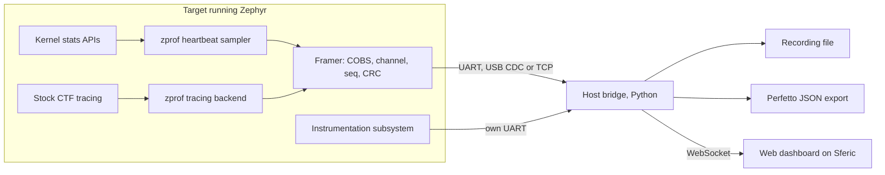

# Zephyr execution profiler and statistics dashboard: research and plan

Status: proposal. A dashboard mockup on synthetic data exists (`web/`); no
firmware or bridge yet. What the dashboard shows, per role, is specified in
[DASHBOARD_SPEC.md](DASHBOARD_SPEC.md).  
Research verified 2026-10-18 against Zephyr `main` source and the v4.4.2 release
(2026-08-07), plus the docs and repos listed in [References](#references).
Working name for the firmware agent below is `zprof`; rename freely.

## 0. Decisions of 2026-11-21 (they override the sections below where they disagree)

The project became a SystemView work-alike: a runtime visualization, timing
and protocol tool, Zephyr thread-aware and Cortex-M55-aware, with the data
over the target's own Ethernet and the dashboard in the browser. It came out
of the STM32N6570-DK demo (`~/projects/stm32n6-demo`), where SEGGER SystemView
over a J-Link cost a 0.6 s core halt per attach, a licence notice per launch
and a probe on the board, and its stop cleared a RIF security register
(RISC_SECCFGR3) over the debug port, blanking the display until the demo
locked its RIF configuration.

| Topic | Decision |
|---|---|
| First target | The STM32N6570-DK running the stm32n6-demo (Zephyr v4.4.0): real deadlines (60 Hz frames, 2.7 ms audio refills) instead of a synthetic load. The Zynq PS stays a later target |
| Zephyr | Pinned to **v4.4.0** (684c9e8f), the demo's, instead of `main` a915b2f1. `CONFIG_TRACING_FORMAT_HEADER` and `tracing_packet_drop_count_get()`, cited below, do not exist there |
| Transport | **TCP on the target's Ethernet** (tcp/5560), one client. Section 8's objection (the network stack runs on the CPU being measured) is answered by measurement, not ignored: the agent's own cost is always on screen, sends are batched, a capture mode records into a RAM buffer with no traffic until upload, and an observer A/B (release build against zprof with and without a client, with the demo's `tour.py`) is a pass criterion in `config/zprof.thresholds.json`. RTT and UART remain possible later transports |
| Trace format | **zprof's own binary records through `CONFIG_TRACING_CUSTOM`** (the module supplies `zephyr_custom_tracing.h`; the hooks it does not record are generated empty from the pinned `tracing.h`). Not CTF (32-bit ns stamps wrap every 4.3 s, no IRQ numbers, a 20-byte name per switch), not `TRACING_USER` (no semaphore, mutex, queue or sleep hooks). Closes section 8's open question and open item 4. The N6 STM path stays a possible later transport for the same records |
| Encoding | One record format for trace and metrics, names and units once in the hello; **no CBOR/zcbor** (flash is tight on the demo: 217 KB left in its 2 MB slot) |
| Names | Resolved on the host from the ELF: interrupt handlers, thread entries, static kernel objects, marker and print format strings (rodata pointers). Zephyr links with `--build-id=none`, so a per-build UUID symbol identifies the ELF |
| Wire protocol | [PROTOCOL.md](PROTOCOL.md) |
| What the observer may cost | The user's rule (2026-11-21): zprof may change the run-time profile as long as the application stays within its timing budget and meets its real-time deadlines. The gate is the application's own faults with zprof streaming (on the demo: 0 dropped frames, 0 audio underruns in a full `tour.py`), not zprof's share of the CPU, which is reported (`agent.self`, measured by zprof itself: sender time plus events x measured hook cost) but not a pass criterion. Comparing single tours of two builds does not measure that share: tour figures vary between runs by as much (upload rate, decode times); compare ranges over several tours per build before quoting a difference |
| Release | Private until the first release, after phase P3 of the new plan (live timeline, replay, Perfetto export, metrics, markers); then public, Apache-2.0 |
| What to record | The user's rule (2026-11-21): not everything all the time; it depends on the task. Capture presets from the page (Scheduling, Timing, Kernel objects) choose the kernel-object classes; target-side counting of the hottest objects stays an option for the Kernel objects preset |
| Schedulability | Added 2026-11-21 at the user's request: rate monotonic (fixed-priority) analysis of the measured system with recommendations and what-ifs, in the bridge and a live view; measurement-based, deadlines from a file. [SCHEDULABILITY.md](SCHEDULABILITY.md). Application markers (P3) will make the jobs of loops without one release object exact |

New phase order: P0 groundwork, P1 trace core and a command-line bridge, P2
capture mode and the live web views, P3 metrics and application markers, R1
first release, P4 M55 PMU and Helium counters, post-mortem and fault capture,
P5 protocol analyzer. Phases B, A and D below are the earlier plan; their
content is reused, their order is replaced.

## 1. Goal

A live profiler and statistics dashboard for Zephyr targets:

- per-thread CPU utilization, stack headroom, heap and slab usage (statistics);
- a scheduler timeline: which thread or ISR owned the CPU, when, and why it
  stopped (tracing);
- function-level cost later (profiling).

The frontend is built on Sferic (`~/projects/lightning`, npm `sferic-charts`).
The firmware side is a small Zephyr module modelled on how Memfault structures
its SDK (metric registry, periodic heartbeat, chunked transport-agnostic
output), but tuned for bench use at 1 to 10 Hz instead of hourly fleet upload.

Planned order: **B** (statistics), then **A** (trace timeline), then **D**
(function profiling). C (fork Zephelin) is deferred; see section 7.

## 2. Research findings

### 2.1 What Zephyr already exposes

| Source | What it gives | Key config / API | Notes |
|---|---|---|---|
| Thread runtime stats | Per-thread and per-CPU cycle counts | `CONFIG_THREAD_RUNTIME_STATS`, `k_thread_runtime_stats_get()`, `k_thread_runtime_stats_all_get()`, `k_thread_runtime_stats_cpu_get()` | `k_thread_runtime_stats_t` has `execution_cycles`, `total_cycles`, `idle_cycles` (CPU only). With `CONFIG_SCHED_THREAD_USAGE_ANALYSIS` also `current_cycles`, `peak_cycles`, `average_cycles`. `CONFIG_THREAD_RUNTIME_STATS_USE_TIMING_FUNCTIONS` switches the clock to the timing subsystem (DWT on Cortex-M). |
| Stack usage | Unused stack bytes per thread | `k_thread_stack_space_get()`, needs `CONFIG_THREAD_STACK_INFO` + `CONFIG_INIT_STACKS` | Scans the fill pattern, so cost scales with stack size. Sample at a lower rate than CPU. |
| Thread list | Iterate live threads | `k_thread_foreach_unlocked()`, `CONFIG_THREAD_MONITOR`, `CONFIG_THREAD_NAME` | |
| Memory | Heap and slab usage | `sys_heap_runtime_stats_get()`, `k_mem_slab_runtime_stats_get()` | |
| CPU load | Load in per mille | `CONFIG_CPU_LOAD`, `cpu_load_get(bool reset)`, `cpu_load_get_cpu()` | Docs: more accurate than Thread Analyzer because it counts ISR time. Runtime stats charge ISR time to the interrupted thread. On `main` the backend matters: `_IDLE_HOOK` (single CPU) counts ISR time, `_RUNTIME_STATS` (SMP default) excludes it (DASHBOARD_SPEC.md section 3.3). |
| Thread Analyzer | Prints the above to log/console | `CONFIG_THREAD_ANALYZER`, `_AUTO`, `_AUTO_INTERVAL` | Text only. Useful as a cross-check, not a transport. |
| MCUmgr taskstat | Thread table over SMP | `CONFIG_MCUMGR_GRP_OS_TASKSTAT` | `runtime` field omitted unless `CONFIG_MCUMGR_GRP_OS_TASKSTAT_ONLY_SUPPORTED_STATS=n`. Request/response, heavy framing. Not a good live feed. |
| CTF tracing | Event stream: thread switch in/out, create, ready, pend, sleep, priority, ISR enter/exit, idle, kernel objects (372 event types in current TSDL) | `CONFIG_TRACING`, `CONFIG_TRACING_CTF`, `CONFIG_TRACING_CTF_TIMESTAMP` | Header is `uint64 timestamp` (from `timing_ns_get()`, so ns) + `uint16 id`, little-endian, packed. Backends: UART, USB, POSIX file, RAM, semihost, ITM, ADSP window. Sync or async (ring buffer up to 64 KiB). |
| Custom tracing backend | Route the CTF byte stream anywhere | `TRACING_BACKEND_DEFINE(name, api)` with `init` + `output(backend, data, len)`; selected by `CONFIG_TRACING_BACKEND_NAME` | Iterable section, so an out-of-tree module can register one. |
| Custom tracing format | Replace CTF entirely | `CONFIG_TRACING_CUSTOM` (v4.4.0; this row said `CONFIG_TRACING_FORMAT_HEADER`, which v4.4.0 does not have), `CONFIG_TRACING_USER` | One entry of `TRACING_FORMAT_CHOICE` with CTF, SystemView and `TRACING_USER`, so a build carries one format. `TRACING_CUSTOM` makes `tracing.h` include `zephyr_custom_tracing.h`, which must define every hook. User hooks receive object pointers for threads, but v4.4.0 has no user hooks for semaphores, mutexes, queues or sleep. zprof uses `TRACING_CUSTOM` (section 0). |
| Instrumentation subsystem | Function entry/exit via `-finstrument-functions` | `CONFIG_INSTRUMENTATION`, modes `_MODE_CALLGRAPH` (trace) and `_MODE_STATISTICAL` (top-N functions, default 256, max 4096) | Merged 2025-10-05 (PR #91595), in 4.3+. GCC only. Transport is UART only (`subsys/instrumentation/transport/uart.c`) and it selects `UART_CONSOLE`. Dynamic trigger/stopper needs a `zephyr,retained-ram` DT node and reboot. Tested on ARM32 boards and `mps2_an385` QEMU. |

### 2.2 Host tooling already in the Zephyr tree

All under `scripts/tracing/` unless noted. Checked on `main`.

| Script | Deps | Use to us |
|---|---|---|
| `trace_viewer.py` (1514 lines) | stdlib only (+ curses) | Reference decoder. Parses the TSDL `metadata` for field layouts with a built-in fallback for core scheduling events. Handles partial records, unwraps timestamps, supports live follow (`-f`), computes per-thread utilization over a window. `TraceReader` and `parse_metadata` are importable (`ctf2perfetto.py` does). |
| `ctf2perfetto.py` | stdlib + `trace_viewer` | CTF to Trace Event JSON for ui.perfetto.dev. Free export path. |
| `parse_ctf.py` | `bt2`, `colorama` | Older babeltrace2-based printer. Not needed. |
| `trace_capture_uart.py`, `trace_capture_usb.py` | `pyserial` / USB | Capture helpers; trivial. |
| `scripts/instrumentation/zaru.py` | `bt2`, `pyserial`, `pyelftools`, `west`, `colorama` | Host CLI for D: `trace`, `profile`, Perfetto export. `bt2`'s documented install is Ubuntu `apt`; expect friction on native Windows. |

### 2.3 Third-party

| Project | Verdict |
|---|---|
| **Zephelin** (Antmicro + ADI, Apache-2.0) | Closest existing system: Zephyr module, CTF over UART/USB/debugger, `west zpl-*` capture and CTF-to-TEF conversion, web trace viewer, CPU/stack/heap/slab and sensor metrics. Aimed at ML inference profiling, no tagged release, defaults to Zephyr 4.3. Good reference, not a base. |
| **Memfault firmware SDK** (v1.45.0) | Architecture worth copying: metrics declared in a `.def` X-macro file (counter, gauge, timer, string; heartbeat vs session scope), a periodic heartbeat with a `collect_data()` hook, CBOR-serialized events in a RAM ring, and a packetizer that cuts everything into transport-sized chunks. **License clause 3: "must only be used with the Memfault services".** We cannot reuse their code for this. Design is clean-room. |
| **Percepio View / Tracealyzer** | Free View tier is snapshot only. Live streaming and execution metrics are in the paid Profile tier. Usable as a ground-truth cross-check if a license is around. |
| **SEGGER SystemView** | RTT live streaming, Friendly License. Commercial-use terms not verified. Cross-check only. |

### 2.4 Gaps nothing above fills

- No open-source **live** dashboard that combines statistics and the scheduler timeline. Perfetto and Zephelin's viewer are post-capture.
- Stock CTF `isr_enter` / `isr_exit` carry **no IRQ number**, so per-IRQ breakdown needs a custom hook (for example reading IPSR on Cortex-M in a custom format).
- CTF `thread_id` is `uint32`. On 64-bit targets (`native_sim/native/64`, ZynqMP A53) it is a truncated pointer; collisions are possible.
- Every switch event carries a 20-byte thread name, which dominates bandwidth (section 8).
- `native_sim` runs only on Linux or WSL 2, not native Windows. The default build is 32-bit and its UART appears as a pty.

### 2.5 Sferic fit (checked in `~/projects/lightning/src`)

| Need | Sferic today | Gap |
|---|---|---|
| Rolling CPU%, rates | `addLineSeries`, `addStepSeries`, `addAreaSeries`, scrolling axes | None. |
| Stack / heap headroom | `BarChart`, `Gauge`, constant lines on axes | None. |
| Thread table | `DataGrid` | None. |
| Run-length / latency distribution | Histogram example (`stats-histogram`), `BoxSeries` | None. |
| Thread-state Gantt | `addRectangleSeries` over a chunked, float64-origin `ShapeBatch` | **Not streaming-scale.** Every rect is a `RectangleFigure` object, `drawGL` rebuilds the whole batch on any change, and picking is a linear scan. Fine to ~10^4 rects, not for 10^5 to 10^6 live intervals. |
| Call-path cost (D) | `TreeMapChart`, `SunburstChart` | None for static profiles. Flame chart reuses the Gantt primitive. |

Phase A therefore includes a Sferic change: an append-only `IntervalSeries`
that pushes straight into `ShapeBatch` (which already has chunked origins and
`dirtyFrom`), evicts by time window, and picks by binary search on start time.
It lands in the `lightning` repo under that project's invariants (no
third-party names, `npm run snap` clean, context-loss safe).

### 2.6 Egress through a debug probe (J-Link / J-Trace PRO)

Researched 2026-10-18. Two distinct paths go through the probe; they are
independent and can run together.

**RTT (Real Time Transfer).** The target writes into a RAM ring; the probe
reads it through a memory access port (MEM-AP) while the CPU runs.

| Fact | Source |
|---|---|
| Background-mode throughput "up to ~3.5 MB/s" on current J-Link / J-Trace PRO (the same page also says "up to 2 MB/s"). Figures are not core-specific; treat 2 MB/s as the planning number. | SEGGER KB, RTT |
| Target cost is roughly a `memcpy` ("one line of text in one microsecond or less"). No driver, no interrupt, no DMA. | SEGGER KB, RTT |
| Background access: mandatory on Cortex-M; on ARMv7-A/R only if the SoC has an AHB-AP/AXI-AP. Stop mode (halts the CPU per access, ~0.4 to 1 ms) is not supported on ARMv8-A/R. | SEGGER KB, RTT; AN08005 |
| MEM-AP accesses bypass MMU, caches and write buffers. RTT control block and buffers must be non-cacheable, ideally in internal RAM, with ordering enforced. SEGGER's RTT code issues `dmb` before every `WrOff` update on ARMv7-A/R. | AN08005 section 1.4; `SEGGER_RTT.h`, `SEGGER_RTT.c` in Zephyr's segger module |
| **Zynq-7000:** "Zynq 7000 devices only implement APB-AP ... and AHB-AP to access system memory space directly." So background RTT is possible on the A9s. | UG585 v1.14, ch. 27 |
| **ZynqMP:** AP0 is an AXI-AP to system memory (OpenOCD drives PMU registers through it). R5 is ARMv7-R, so background RTT is plausible. A53 is ARMv8-A, where SEGGER's page lists no RTT mode. | OpenOCD `xilinx_zynqmp.cfg`; SEGGER KB, RTT |
| Zephyr: `CONFIG_USE_SEGGER_RTT` needs `HAS_SEGGER_RTT`, which no `soc/xlnx` SoC selects (code search found none), so our module or a board overlay must select it. `SEGGER_RTT_SECTION_CUSTOM_DTS_REGION` places RTT in a devicetree memory region (for example OCM marked non-cacheable). Cortex-A has `NOCACHE_MEMORY` unconditionally; Cortex-R only with MPU + D-cache. | `modules/segger/Kconfig`, `arch/arm/core/Kconfig` |
| Zephyr's `segger,rtt-uart` driver exposes RTT channels as UART devices, but the CTF UART backend calls `uart_poll_out()` per byte. Our own backend (Phase A) should write whole packets instead. | `drivers/serial/uart_rtt.c`, `subsys/tracing/tracing_backend_uart.c` |
| Host: `pylink-square` (v2.0.2, 2026-10-06) opens a probe by USB serial or `ip_addr="host:port"` and exposes `rtt_start(block_address)`, `rtt_read(buffer_index, n)` and `rtt_write()` (down channel for control). J-Link's own RTT telnet server on port 19021 defaults to channel 0. | pylink `jlink.py`; SEGGER KB, RTT |

**The probe's Ethernet does not make RTT faster.** The limit is JTAG/SWD clock
(J-Trace PRO: up to 50 MHz) and MEM-AP transfer overhead, not the 1 Gb/s host
link. Ethernet buys placement: probe beside the board, host anywhere,
galvanic isolation from the PC, no USB driver issues.

**Trace port (TPIU) streaming.** J-Trace PRO captures the parallel trace port
continuously (Gigabit Ethernet or USB 3.0 to host, trace clock up to 200 MHz).

| Fact | Source |
|---|---|
| Zynq-7000 streaming trace: J-Trace PRO HW V3.0+, TPIU on MIO 22 to 27 (4-bit) via a SEGGER script, or EMIO through the PL (bitstream must be loaded first). EMIO supports up to 32-bit trace data. | SEGGER KB, Xilinx Zynq-7000; UG585 ch. 27 |
| ZynqMP: ETB buffer trace works out of the box on all A53 and R5 cores; streaming needs the trace pins routed through the PL to a header. | SEGGER KB, Zynq UltraScale+ |
| Zynq-7000 has an ITM with 32 software-writable stimulus ports feeding the same funnel and TPIU as the PTMs. | UG585 |
| Zephyr's ITM tracing backend depends on `ARMV7_M_ARMV8_M_MAINLINE` (Cortex-M only); Zynq needs our own stimulus-port writer. | `subsys/tracing/Kconfig` |
| pylink wraps SEGGER's STRACE API: `strace_configure(port_width)` (1, 2 or 4 bits), `strace_start()`, `strace_read(n)` returns up to 65,536 executed instruction addresses. | pylink `jlink.py` |
| UG585 itself suggests looping EMIO trace back into PS DDR or exporting it over Gigabit Ethernet from the PL. | UG585 ch. 27 |

Not found: any SEGGER host API that returns ITM stimulus data captured on the
parallel trace port (pylink's `swo_read_stimulus` is SWO only). Until that is
confirmed, ITM-over-TPIU is a silicon capability without a host path.

### 2.7 STM32N6570-DK (second target, development practice)

Researched 2026-10-18 against Zephyr `main` a915b2f1, UM3300, RM0486 and the
MB1939C schematic. Board quirks from bring-up (FSBL variant, boot pins,
signing, the `ap=1` runner bug) are in `~/projects/STM32N6570-DK/CLAUDE.md`;
the `ap=1` line is still in `board.cmake` at a915b2f1.

| Fact | Source |
|---|---|
| Parts ship BSEC-closed. In Flash boot (BOOT0 = BOOT1 = L) debug stays closed until secure-privileged code writes `BSEC_DBGCR.DBG_UNLOCK = 0xB4` and `BSEC_AP_UNLOCK = 0xB4`, once per reset; hot plug is impossible otherwise. Nothing in Zephyr writes them. So RTT and trace in normal running need our firmware to open debug. The offsets (BSEC +0xE8C and +0xE90; BSEC at 0x46009000, secure alias 0x56009000) match ST's SVD V1.0. | RM0486 3.9, 4.5.18-19, 78.7.1; `git grep` at a915b2f1; `STM32N657.svd` |
| CN10 is a MIPI-20 connector for an external J-Link / J-Trace: SWD, SWO (PB5), and 4-bit ETM (TRACECLK PG7, TRACED0-3 on PE3/PB0/PB6/PB7 through solder bridges). The trace pins are shared with SAI1, which Zephyr's board DT enables. | UM3300 8.8 Table 17; schematic p.20 |
| SEGGER lists STM32N657X0 as supported, and J-Trace PRO tracing for STM32N6 was announced in June 2025. OpenOCD has `stm32n6x.cfg` on mainline only (no release); use `stlink-dap`, not `hla`. The M55 is on AP1, which resets to non-secure accesses, while Zephyr runs at the secure RAM alias. | SEGGER device list and press release; OpenOCD `tcl/target/stm32n6x.cfg`; RM0486 78.10.2 |
| The M55 has an L1 D-cache with no uncached alias, so SEGGER's `SEGGER_RTT_CPU_CACHE_LINE_SIZE` scheme does not apply. RTT buffers must live in a non-cacheable region: the 8 KB backup SRAM (non-cacheable, disabled by default) or a devicetree region marked `ATTR_MPU_RAM_NOCACHE` with `SEGGER_RTT_SECTION_CUSTOM_DTS_REGION`. | `SEGGER_RTT.h` in module 50892fdb; `modules/segger/Kconfig`; N6 dtsi |
| Without a probe: USB HS device (CDC ACM via `UDC_STM32`) and Ethernet (RGMII, RTL8211F, RJ45 CN16). The STLINK VCP is documented only at 115200. | board twister yaml; UM3300 7.13, 7.19 |
| Zephyr builds N6 with single-precision FPU flags (`CPU_HAS_FPU_DOUBLE_PRECISION` not selected) although the silicon has double precision, so double math is software. | `soc/st/stm32/stm32n6x/Kconfig`; DS14791 section 2 |

## 3. Architecture



Proposed layout of this repo:

```text
zephyr-dev/                west workspace root (west init -l firmware; /zephyr, /modules ignored)
  firmware/west.yml        manifest: Zephyr main pinned by SHA                      [exists]
  firmware/zprof/          Zephyr module (zephyr/module.yml, Kconfig, CMakeLists, include/, src/)
  firmware/apps/loadgen/   demo app: tunable thread mix, ISR load, heap churn
  host/bridge/             Python bridge (.venv local), capture, decode, record, serve
  config/                  zprof.thresholds.json + schema: live levels, pass criteria, build gate [exists]
  web/                     Vite + TypeScript dashboard on Sferic; mockup today      [exists]
  docs/PLANS.md, docs/DASHBOARD_SPEC.md
  run.cmd                  starts the dashboard (later: bridge + dashboard)         [exists]
```

The dashboard dev server has port 8781 in `~/.claude/port-registry.md`; the
bridge WebSocket gets the next free port when it is built.

## 4. Firmware agent (`zprof`), Memfault-style

Clean-room design; borrows concepts, not code.

**Metric registry.** An application-owned `zprof_metrics.def` X-macro file
declares custom metrics alongside the built-ins:

```c
ZPROF_METRIC(rx_bytes,      ZPROF_COUNTER)
ZPROF_METRIC(batt_mv,       ZPROF_GAUGE)
ZPROF_METRIC(radio_on,      ZPROF_TIMER)   /* ms per heartbeat interval */
```

`ZPROF_ADD()`, `ZPROF_SET()`, `ZPROF_TIMER_START/STOP()` update RAM only;
values are latched and reset at each heartbeat.

**Heartbeat.** A `k_work_delayable` on a dedicated work queue fires every
`CONFIG_ZPROF_HEARTBEAT_MS` (default 100). Each heartbeat carries:

- system: uptime, CPU `execution_cycles` / `idle_cycles` deltas, `cpu_load_get()`;
- per thread: id, name (first sighting only), priority, state, `total_cycles`
  delta, and with `SCHED_THREAD_USAGE_ANALYSIS` the peak and average run length;
- every Nth heartbeat (`CONFIG_ZPROF_STACK_DIVIDER`, default 10): unused stack per
  thread, heap and slab stats;
- custom metrics from the `.def` file;
- self-cost: cycles `zprof` itself spent producing this heartbeat, so the
  observer effect is always on screen.

CPU% is computed on the host from cycle deltas, so the firmware does no division.

**Serialization.** Decided 2026-11-21 (section 0): heartbeat metrics are
METRIC records in the same binary format as the trace, with names, types and
units once in the hello; no CBOR. The trace format is zprof's own
([PROTOCOL.md](PROTOCOL.md)).

**Framing and transport.** One link carries all channels:

```text
COBS( u8 channel | u8 flags | u16 seq | payload | u16 crc16 ) 0x00
channel 0 = hello/control, 1 = heartbeat, 2 = CTF bytes, 3 = log text (optional),
          4 = watch samples, 5 = heap calls
```

COBS resynchronizes after byte loss on a UART, and per-channel `seq` makes drops
visible on the host. Transport is a small vtable (`init`, `write`, `can_write`)
with UART, USB CDC ACM, RTT and native_sim pty implementations. Since
2026-11-21 the first transport is TCP on the target's Ethernet, framed without
COBS and CRC ([PROTOCOL.md](PROTOCOL.md) section 1); the others follow. A dedicated UART
or a second CDC ACM instance is preferred so `printk` never interleaves with
frames; channel 3 exists for boards that have only one serial link.

**RTT transport** (preferred whenever a J-Link / J-Trace is attached; section
2.6): a dedicated up-buffer (channel 1, leaving channel 0 for console),
written with whole frames via `SEGGER_RTT_WriteSkipNoLock()` under our own
lock. Mode is skip-on-full, so the target never stalls and drops show up as
`seq` gaps. The RTT control block and buffers live in a non-cacheable region
(`SEGGER_RTT_SECTION_CUSTOM_DTS_REGION`, OCM on Zynq). The down-buffer carries
host commands (heartbeat rate, trace on/off). Sizing: 8 KiB absorbs about
4 ms of output at 2 MB/s. The probe's real poll interval is unknown, so start
at 16 KiB and size from measured drops.
Lowest observer effect of any transport: one `memcpy` and a `dmb` per frame.

On the STM32N6570-DK (section 2.7) two more pieces are needed. The RTT
section goes in a non-cacheable devicetree region: backup SRAM is the
zero-config choice, but at 8 KB it caps the up-buffer, so a NOCACHE AXISRAM
region is the real one. A `CONFIG_ZPROF_N6_DEBUG_OPEN` option writes
`BSEC_DBGCR` and `BSEC_AP_UNLOCK` early in secure boot. That re-opens a
production security boundary, so it is default n, intended for the DK only,
and reported in the hello record. Without it the bridge falls back to USB
CDC ACM.

**Hello record** (channel 0, sent on connect and on request): firmware and Zephyr
versions, ELF build ID (needed for symbolization in D), cycles per second for
both the kernel clock and timing functions, heartbeat period, CTF metadata hash.

**Additions required by the dashboard spec** (DASHBOARD_SPEC.md sections 3.7
and 3.10): span, state and mark registry kinds, with spans aggregated into
log2 histograms when tracing is off; a fatal-error record and last-gasp uptime
in retained RAM, reported on the next boot; a boot counter; reset cause in the
hello record; a counting log backend (levels and drops); task watchdog
expiry records; switch and ISR counters that run with trace streaming off.

**Parameter registry (the write path; DASHBOARD_SPEC.md section 14).**
`ZPROF_PARAM(id, type, min, max, step, unit, owner)` entries live in an
iterable section inside the NOCACHE window, each with a seqlock. The host
sends `PARAM_SET {seq, id, value}` on the down buffer (channel 0). The zprof
thread polls the down buffer every 5 ms, range-checks the value again, and
either rejects it or stages it for the owner; the owning thread calls
`zprof_param_apply(owner)` at its safe point (top of its loop, timer callback,
or a condition such as "bus idle" for flags that swap a lock type). Each step
goes up as `PARAM_ACK {seq, state, t_target}` (staged, applied, rejected with
a reason) and as a trace event, so the change is visible at the instant it
took effect. Never applied from an ISR unless the entry says so.

**Watch block.** `ZPROF_WATCH(id, type)` entries are written by their owners
(for example ctrl_loop after each actuation) into a ring in the NOCACHE window
with target timestamps, drained by the zprof thread on channel 4. Probe-visible
by construction, so a J-Link can also read them without the agent.

**Heap calls.** Stock CTF is not enough for an allocator map at a915b2f1:
`heap_alloc_exit` carries the pointer but not the size, and `heap_free` carries
neither (the `k_heap` free hook only receives the heap). zprof therefore wraps
`k_malloc`, `k_free`, `k_heap_alloc`, `k_heap_aligned_alloc` and `k_heap_free`
at link time (`zephyr_ld_options(-Wl,--wrap=...)`) and emits `{op, heap, addr,
size, thread, caller PC}` on channel 5, sizing blocks with
`sys_heap_usable_size()`. The caller PC gives each block a call site, not just
a thread. `--wrap` only sees calls across object files, which covers callers of
the public API.

**Kernel-object events.** The X-ray, Trace, Objects and Timing views need the
CTF object events (`semaphore_*`, `mutex_*`, `msgq_*` with `_blocking`,
`fifo_*`, `timer_expiry_*`, `work_*`, all present at a915b2f1) plus
`thread_priority_set` for inheritance boosts. They pass through channel 2 like
the scheduler events; enable them per class (`CONFIG_TRACING_SEMAPHORE` and
siblings) and filter by object id in the zprof backend when the link is short
(section 8).

**Kconfig sketch:** `CONFIG_ZPROF`, `_HEARTBEAT_MS`, `_STACK_DIVIDER`,
`_TRANSPORT_{UART,USB_CDC}`, `_TRACE` (registers the tracing backend for A),
`_BUF_SIZE`. `CONFIG_ZPROF` selects `THREAD_RUNTIME_STATS`,
`SCHED_THREAD_USAGE_ANALYSIS`, `THREAD_MONITOR`, `THREAD_NAME`,
`THREAD_STACK_INFO`, `INIT_STACKS`, `CPU_LOAD`.

## 5. Host bridge

Python 3, project-local `.venv`, `pyserial` + `websockets` on `asyncio`.

- **Inputs:** serial port, TCP (QEMU serial socket, `-DQEMU_SOCKET=y`), pty
  (`native_sim` under WSL 2), J-Link RTT through `pylink-square` (probe by USB
  serial or IP), or a recording file for replay.
- **Decode:** COBS deframe, CRC check, per-channel seq tracking. Heartbeat CBOR
  to dicts. CTF channel through a decoder derived from `trace_viewer.py`
  (`TraceReader`, `parse_metadata`, imported from `$ZEPHYR_BASE` or vendored
  with its Apache-2.0 header). Event IDs always come from the TSDL `metadata`
  matching the firmware's Zephyr version, never hard-coded.
- **Normalize** to three record kinds sent to the browser:
  `Sample {metric, t, value}`, `Interval {lane, t0, t1, state}`,
  `Snapshot {threads[...]}`. Derived metrics (run lengths, ready-to-run
  latency, switch and ISR rates) are computed here, once, so a CLI report and
  the dashboard share one implementation.
- **Record** raw frames to an append-only file. Replay feeds the same pipeline.
- **Export:** the CTF channel is written out next to `metadata` so
  `ctf2perfetto.py`, `trace_viewer.py` and babeltrace2 all work on our captures.
- **Back-pressure:** the browser gets a decimated stream at the zoom level in
  view; history beyond the live window is fetched on demand from the recording.
- **Derived for the hybrid views** (DASHBOARD_SPEC.md sections 13 and 14):
  kernel events normalized to `{t, ctx, obj, call, result, peer, value}` with
  give / put / unlock paired to the resume they caused; lock ownership (from
  `mutex_lock_exit`, and inferred from take / give pairs for a semaphore used
  as a lock); per-job decomposition (release from the trigger, then ISRs,
  preempting threads, holder time and inversion until completion); the heap
  map from channel 5; and the insight rules, evaluated once a second. The
  mockup's `web/src/sim/query.ts`, `explain.ts` and `insights.ts` are the
  reference behavior to port.
- **Parameter path:** sends `PARAM_SET`, tracks acks, keeps the audit trail in
  the recording, and refuses to send unless the UI armed writes.

## 6. Phases

### Phase B: statistics dashboard

| Deliverable | Detail |
|---|---|
| `firmware/zprof` | Registry, heartbeat, CBOR, framing, UART + USB CDC transports, hello record. |
| `firmware/apps/loadgen` | Threads with configurable duty cycle and priority, a timer ISR at a configurable rate, heap churn. Known inputs for validation. |
| `host/bridge` | Serial/TCP/pty input, decode, record, replay, WebSocket. |
| `web` | Sferic `Dashboard`: total CPU (line), per-thread CPU% (stacked area), stack headroom (bars with a threshold line), heap gauges, thread `DataGrid`, custom metrics as lines. |
| `run.cmd` | One-step launcher per the global convention. |

Exit criteria:

- Runs on `native_sim` (WSL 2) or QEMU, and on both targets (STM32N6570-DK,
  Zynq PS).
- Per-thread CPU% plus idle sums to 100% within 1% per heartbeat.
- `loadgen` duty cycles are recovered within 2% absolute.
- Results agree with `CONFIG_THREAD_ANALYZER` output on the same build.
- Self-cost is reported, and is under 1% CPU at 10 Hz on the reference board.

### Phase A: scheduler timeline

| Deliverable | Detail |
|---|---|
| Trace format decision | First task, on measurements: CTF passthrough, a zprof format through `TRACING_FORMAT_HEADER`, or on the N6 the STM with an ETR ring (section 8). The rows below assume CTF. |
| `zprof` tracing backend | `TRACING_BACKEND_DEFINE` that wraps CTF bytes into channel 2. A Kconfig entry added to `TRACING_BACKEND_CHOICE` plus a `TRACING_BACKEND_NAME` default from the module (prototype this first: extending the named choice from out of tree is the assumption to prove). |
| Bridge CTF path | Live decode, thread-state intervals, ISR lane, derived latency and run-length stats. |
| Sferic `IntervalSeries` | Append-only, windowed, binary-search pick (section 2.5). Lands in `lightning` with a gallery example and snap coverage. |
| Dashboard | Thread-state Gantt with ISR lane, switch and ISR rate lines, run-length and wake-latency histograms, all linked to one time cursor. Phase B panels stay live alongside. |

Exit criteria:

- Per-thread runtime from the timeline matches Phase B heartbeats on the same
  run (two independent measurement paths) within 1%.
- Same capture gives the same per-thread totals in `trace_viewer.py --text` and
  in Perfetto via `ctf2perfetto.py`.
- Sustains the measured link budget (section 8) with drops visible on screen,
  never silent.
- Gantt stays interactive (under 16 ms frames on the Arc iGPU bench) with 10^6
  intervals resident.

### Phase D: function profiling

Built on the in-tree instrumentation subsystem rather than our own compiler
hooks.

| Deliverable | Detail |
|---|---|
| Board support | Retained-RAM DT overlay and a second UART for the instrumentation transport (it owns its UART and selects `UART_CONSOLE`). |
| Host decode | Either drive `zaru.py` under WSL 2, or port its decode path into the bridge to avoid `bt2` on Windows. Decide after a spike; symbolization uses `pyelftools` and the ELF matched by build ID from the hello record. |
| Dashboard | Top-N function table (`DataGrid`), inclusive cost by call path (`SunburstChart` / `TreeMapChart`), flame chart on `IntervalSeries` from Phase A. |

Exit criteria: top-N on `loadgen` matches `zaru profile` on the same build;
instrumentation overhead is measured and stated next to the results.

Constraints to keep in view: GCC only; `-finstrument-functions` adds a hook to
every function, so use `CONFIG_INSTRUMENTATION_EXCLUDE_FUNCTION_LIST` and
`__no_instrumentation__` to keep overhead tolerable; tested upstream only on
ARM32.

**D-alt: hardware instruction trace (if the board breaks out trace pins).**
With a J-Trace PRO, PTM/ETM streaming gives function-level profiling with
**zero code change and zero target overhead**, which compiler instrumentation
cannot. The bridge reads executed instruction addresses through STRACE
(`pylink` `strace_*`) and buckets them by function using the ELF symbol table
matched by build ID. Before committing: confirm the board routes TPIU to a
header (Zynq-7000 MIO 22 to 27, or EMIO with a PL bitstream; ZynqMP only via
PL), and measure whether STRACE delivers a continuous stream or only the last
65,536 instructions per read. If it is a window, it is a statistical sampler,
still useful but not exact. Either way, ETB buffer trace (ZynqMP, all cores)
covers short captures without pins.

The STM32N6570-DK is the easier D-alt target: its 4-bit ETM is already routed
to CN10 and SEGGER supports N6 tracing on the J-Trace PRO. That needs SAI1
disabled in the overlay, the trace solder bridges checked, and debug opened in
Flash boot (section 2.7). Prove D-alt there before routing trace through a
Zynq PL.

## 7. Deferred and rejected

- **C, fork Zephelin:** deferred. Revisit if sensor or ML-layer profiling is
  wanted. Its `west` capture commands and USB setup are worth reading before
  Phase A.
- **MCUmgr taskstat as the B transport:** rejected. Request/response over SMP
  is too heavy for 10 Hz and omits runtime by default.
- **Reusing the Memfault SDK:** rejected by its license (section 2.3).
- **Percepio / SystemView as the frontend:** out of scope; cross-check only.

## 8. Link budget

Arithmetic from the current TSDL with `CONFIG_TRACING_CTF_TIMESTAMP=y`
(10-byte header). Not yet measured.

| Item | Bytes |
|---|---|
| `thread_switched_out` + `thread_switched_in` (one context switch) | 34 + 34 = 68 |
| `isr_enter` + `isr_exit` | 10 + 10 = 20 |
| Phase B heartbeat, 16 threads (estimate) | about 450 |
| One kernel call traced (enter + exit, object id only) | 14 + 14 = 28; more with timeout and return fields |

| Link | Usable B/s (approx) | B: heartbeats at 10 Hz | A: switches/s left after a 1 kHz tick ISR (20 KB/s) |
|---|---|---|---|
| UART 115200 | 11.5 K | fits (4.5 KB/s) | none: the tick alone exceeds the link |
| UART 1 Mbaud | 100 K | fits | about 1,200 |
| USB FS CDC ACM | on the order of 1 M | fits | about 14,000 |
| J-Link / J-Trace RTT, background mode | 2 M (SEGGER: up to ~3.5 M) | fits | about 29,000 (51,000 at 3.5 MB/s) |
| Target Ethernet (Zynq GEM, `eth_xlnx_gem`) | 10 M to 100 M | fits | far beyond need |
| TPIU trace port to J-Trace PRO | port width x trace clock, shared with PTM | n/a | no host API found for ITM data (section 2.6) |

Superseded 2026-11-21 (section 0): the first transport is TCP on the target's
Ethernet, and the objection below is answered by measurement (an observer A/B
pass criterion), the agent's cost on screen, batching and a capture mode. The
original reasoning, kept for the record:

RTT is the planning default with a probe attached: about 2x USB FS, and the
cheapest on the target. Target-side Ethernet has the most headroom but runs a
network stack, interrupts, DMA and cache maintenance on the CPU being
profiled, so it distorts exactly what we measure. Keep it for heartbeat-rate
data, or for a PL-assisted path where the fabric drains a DDR ring without the
CPU. On ZynqMP an AMP split also works: Zephyr on the R5 writes a shared OCM
ring, Linux on the A53 forwards it over Ethernet. On the STM32N6570-DK the
probe-free fast path is USB HS CDC ACM (throughput not measured); like
Ethernet, it runs a stack on the CPU being profiled.

Kernel-object events are the expensive part of the hybrid views. In the
mockup's model (about 7,000 switches, 3,300 ISRs and 17,000 kernel calls per
second, network bursts at 4,200 packets/s) full object tracing over a 2 MB/s
RTT link runs at a median 50% and a p95 of 94%. On hardware: measure first,
then trace only the object classes in question, filter by object id in the
backend, or adopt the compact format below.

Consequences: B works over any UART. A needs RTT, USB, a fast UART, or RAM
snapshot mode for busy systems. If that is still short, a compact
out-of-tree format via `CONFIG_TRACING_FORMAT_HEADER` (thread name sent once,
delta timestamps) could cut a switch from 68 to under 16 bytes, at the cost of
compatibility with `trace_viewer.py`, Perfetto conversion and babeltrace2. Only
do that with measurements in hand.

**Phase A format decision.** Decided 2026-11-21: the zprof format through
`CONFIG_TRACING_CUSTOM` (section 0; the option is called that in v4.4.0, not
`TRACING_FORMAT_HEADER`). The options as they were weighed:

| Option | Gains | Costs |
|---|---|---|
| CTF passthrough (planning default) | `trace_viewer.py`, Perfetto via `ctf2perfetto.py`, babeltrace2 work unchanged | 68 B per switch; no IRQ number at `isr_enter`; no object state, so the bridge infers lock holders |
| zprof format via `TRACING_FORMAT_HEADER`, user-hook style | Object pointers at every hook, so semaphore count, queue fill and mutex owner at the event; IRQ number from IPSR; compact encoding | Our own decoder; the bridge exports CTF or Perfetto for the tools |
| N6 only: events to STM stimulus ports, drained by the ETR into a RAM ring | One store per event, hardware timestamps and serialization, merges with ETM instruction trace; no RTT copy on the CPU | Needs an STM devicetree node and a funnel / ETF / ETR setup driver (Zephyr has the `arm,stmesp` binding, the STP decoder and the CoreSight deformatter); unknowns in [OBSERVABILITY_AND_SVD_REVIEW.md](OBSERVABILITY_AND_SVD_REVIEW.md) section 5 |

Spike the STM path on the DK before the backend is built, since it changes
what the backend is.

## 9. Risks and open questions

Risks:

- **Zephyr drift.** Tracing hooks move between releases. Zephyr is pinned by
  SHA in `firmware/west.yml` (v4.4.0 since 2026-11-21); bump it deliberately
  and re-check DASHBOARD_SPEC.md section 3. Hooks zprof does not record are
  generated from the pinned `tracing.h` at build time, so a new hook is empty
  rather than a build break.
- **Ring drops.** zprof does not use Zephyr's tracing core or its async ring
  (and v4.4.0 has no `tracing_packet_drop_count_get()`). Its own ring drops
  when full and says so: an OVERFLOW record with the count, the time and the
  running thread ([PROTOCOL.md](PROTOCOL.md)).
- **Observer effect.** Tracing and heartbeat cost are reported, and every A/B
  comparison is made with the same build.
- **ISR accounting.** Runtime stats fold ISR time into the interrupted thread;
  only `cpu_load` and the A timeline separate it. The dashboard labels which
  source each number comes from.

- **RTT on Zynq is unproven here.** UG585 confirms the AHB-AP, but no SEGGER
  page states RTT background-mode support for a Zynq part. First hardware task:
  RTT round trip on the target board, then measure sustained MB/s over the
  probe's Ethernet and over USB.
- **Probe sharing.** The bridge holds a J-Link connection for RTT. Whether
  Ozone or a GDB session can debug the same target at the same time has not
  been checked.
- **A53 RTT.** ARMv8-A has no RTT mode in SEGGER's table. If the profiled code
  runs on the A53s, plan on target Ethernet, the AMP relay, or USB instead.
- **N6 debug in Flash boot.** Debug is closed until our firmware opens it
  (section 2.7). Unverified: whether DWT CYCCNT counts while debug is closed
  (RM0486 78.6.2), which matters for timing functions and instrumentation even
  with no probe attached. First N6 task: an RTT round trip in Flash boot with
  the unlock, and CYCCNT checked with it off.
- **N6 probe access is secure-only.** Zephyr's RAM is at the secure alias and
  AP1 resets to non-secure accesses; confirm that J-Link and OpenOCD
  `stlink-dap` both read the RTT control block.
- **Probe writes and the D-cache.** Whether M55 debug accesses through AP1
  are coherent with the L1 D-cache is unverified; on the Zynq they are not
  (MEM-AP bypasses the caches). Keep every probe-visible variable in the
  NOCACHE window, and route writes through the agent registry.
- **Lock-type flags at run time.** An A/B flag that swaps a k_sem for a
  k_mutex deadlocks a waiter if applied mid-wait. Such flags apply only at a
  safe point with no holder and no waiters (the mockup does this).
- **Semaphores have no owner.** Inversion through a semaphore used as a lock
  is detected from inferred ownership (take / give pairs in one thread); a
  semaphore given by another thread breaks the inference, and the bridge must
  say so rather than guess.

Decided (2026-10-18):

- **Targets:** a Zynq PS, and the STM32N6570-DK (Cortex-M55) for development
  practice. DASHBOARD_SPEC.md section 11 compares what each supports.
- **Zephyr:** `main`, pinned by SHA in `firmware/west.yml`. Changed
  2026-11-21: v4.4.0 (section 0).
- **Pass criteria:** in the thresholds file `config/zprof.thresholds.json`
  (DASHBOARD_SPEC.md section 7.2).
- **Sferic dependency (de facto):** local source path, because the mockup's new
  charts use Sferic internals; revisit when they move upstream.

Still open:

1. Which Zynq part and board (Zynq-7000 A9 or ZynqMP R5), and does it break
   out trace pins (needed for D-alt)?
2. Which J-Trace PRO model and hardware version (streaming trace on Zynq needs
   HW V3.0+)?
3. Firmware agent name (`zprof` is a placeholder).
4. ~~Phase A trace format: CTF, a zprof format, or the N6 STM (section 8).~~
   Decided 2026-11-21: the zprof format (section 0).

## References

Zephyr:

- [Tracing docs](https://docs.zephyrproject.org/latest/services/tracing/index.html)
- [Tracing sample](https://docs.zephyrproject.org/latest/samples/subsys/tracing/basic/README.html)
- [`scripts/tracing/`](https://github.com/zephyrproject-rtos/zephyr/tree/main/scripts/tracing) (`trace_viewer.py`, `ctf2perfetto.py`, capture scripts)
- [`subsys/tracing/Kconfig`](https://github.com/zephyrproject-rtos/zephyr/blob/main/subsys/tracing/Kconfig), [`tracing_backend.h`](https://github.com/zephyrproject-rtos/zephyr/blob/main/subsys/tracing/include/tracing_backend.h), [CTF `metadata`](https://github.com/zephyrproject-rtos/zephyr/blob/main/subsys/tracing/ctf/tsdl/metadata)
- [CPU load](https://docs.zephyrproject.org/latest/services/debugging/cpu_load.html), [Thread Analyzer](https://docs.zephyrproject.org/4.1.0/services/debugging/thread-analyzer.html)
- [Instrumentation RFC #57373](https://github.com/zephyrproject-rtos/zephyr/issues/57373), [PR #91595](https://github.com/zephyrproject-rtos/zephyr/pull/91595), [`subsys/instrumentation`](https://github.com/zephyrproject-rtos/zephyr/tree/main/subsys/instrumentation), [`zaru.py`](https://github.com/zephyrproject-rtos/zephyr/blob/main/scripts/instrumentation/zaru.py)
- [native_sim](https://docs.zephyrproject.org/latest/boards/native/native_sim/doc/index.html), [POSIX arch host support](https://docs.zephyrproject.org/latest/boards/native/doc/arch_soc.html)
- [MCUmgr taskstat Kconfig](https://codex.ac6.fr/Zephyr/xref/Zephyr-latest/subsys/mgmt/mcumgr/grp/os_mgmt/Kconfig)

Debug probe and Zynq:

- [SEGGER KB: RTT](https://kb.segger.com/RTT), [AN08005 RTT on Cortex-A/R](https://www.segger.com/downloads/application-notes/AN08005), [J-Link zoned memory access](https://kb.segger.com/J-Link_zoned_memory_access)
- [SEGGER KB: Xilinx Zynq-7000](https://kb.segger.com/Xilinx_Zynq-7000), [SEGGER KB: Zynq UltraScale+](https://kb.segger.com/Xilinx_Zynq_UltraScalePlus), [J-Trace PRO](https://www.segger.com/products/debug-probes/j-trace/models/j-trace/)
- [UG585 Zynq-7000 TRM v1.14](https://docs.amd.com/r/en-US/ug585-zynq-7000-SoC-TRM) (ch. 27 JTAG and DAP subsystem)
- [OpenOCD `xilinx_zynqmp.cfg`](https://github.com/openocd-org/openocd/blob/master/tcl/target/xilinx_zynqmp.cfg), [pylink-square](https://github.com/square/pylink)
- Zephyr: [`modules/segger/Kconfig`](https://github.com/zephyrproject-rtos/zephyr/blob/main/modules/segger/Kconfig), [`uart_rtt.c`](https://github.com/zephyrproject-rtos/zephyr/blob/main/drivers/serial/uart_rtt.c), [`eth_xlnx_gem.c`](https://github.com/zephyrproject-rtos/zephyr/blob/main/drivers/ethernet/eth_xlnx_gem.c)

Third-party:

- [Zephelin](https://github.com/antmicro/zephelin), [Zephelin Trace Viewer](https://antmicro.github.io/zephelin/_static/trace_viewer/index.html)
- [Memfault metrics API](https://docs.memfault.com/docs/mcu/metrics-api), [data packetizer](https://docs.memfault.com/docs/mcu/data-from-firmware-to-the-cloud), [built-in metrics](https://docs.memfault.com/docs/mcu/mcu-builtin-metrics), [SDK license](https://github.com/memfault/memfault-firmware-sdk/blob/master/LICENSE)
- [Percepio View announcement](https://percepio.com/a-new-free-but-professional-grade-trace-diagnostics-tool-aimed-at-embedded-developers-working-with-freertos-and-zephyr-rtos/)
- [Perfetto: other trace formats](https://perfetto.dev/docs/getting-started/other-formats), [KDAB ctf2ctf](https://github.com/KDABLabs/ctf2ctf)
